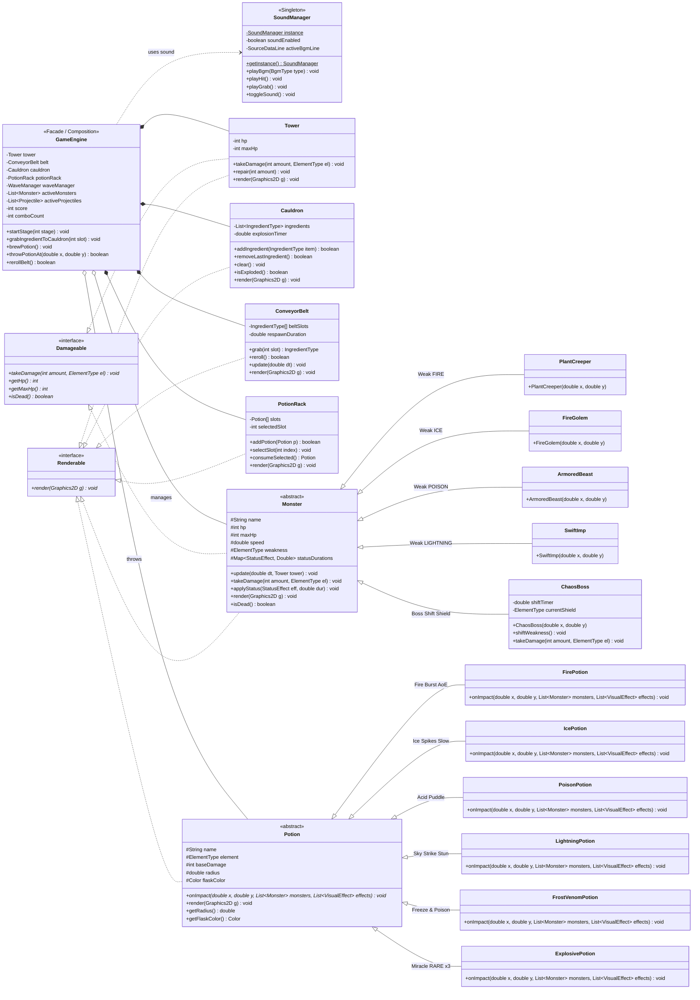
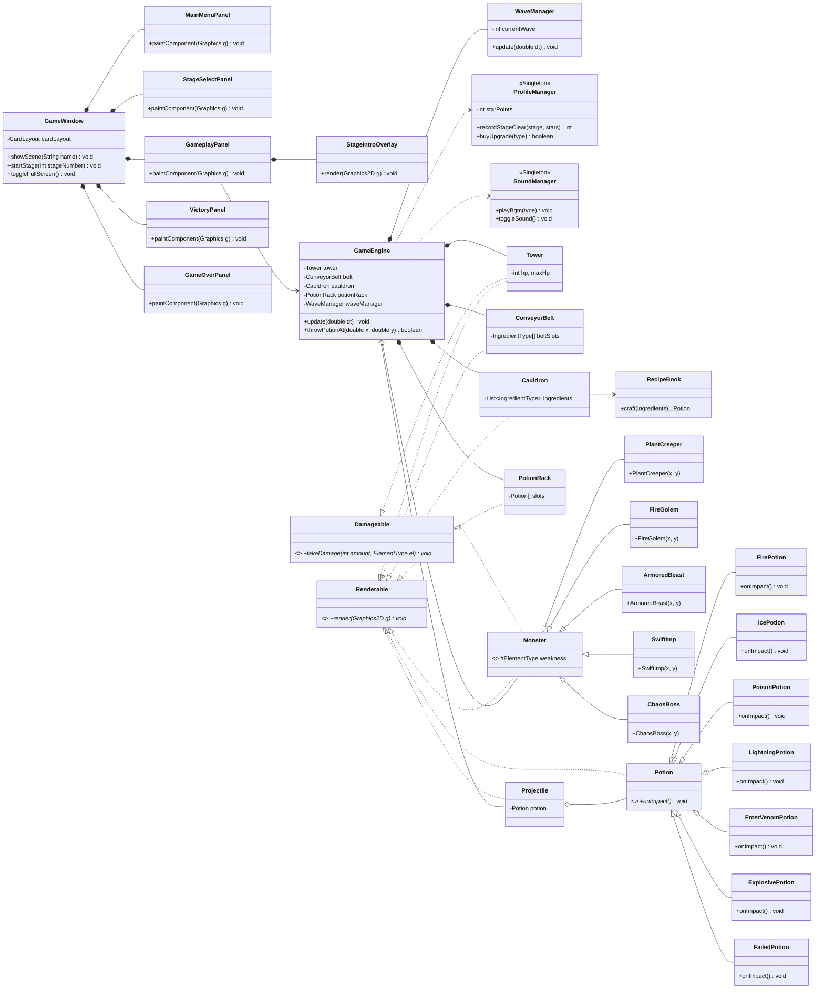

# POTION PANIC - แผนภาพ Class Diagram แนวนอน (Mermaid Syntax - Landscape / Direction LR)

เอกสารนี้รวบรวมโค้ด Mermaid Syntax สำหรับนำไปวางใน [Mermaid Live Editor](https://mermaid.live), GitHub Markdown, Notion หรือเครื่องมือสร้าง Diagram โดยจัดวางในทิศทาง **แนวนอน (direction LR)** เพื่อให้เห็นภาพรวมและสถาปัตยกรรม OOP ได้อย่างชัดเจนที่สุด

---

## รูปแบบที่ 1: Core OOP Architecture (ฉบับเน้น 6 เสาหลัก OOP - แนะนำที่สุดสำหรับรายงาน)
> **จุดเด่น:** จัดวางแนวนอนจากซ้ายไปขวา (Singleton -> Engine -> Interfaces -> Concrete Classes) ตัวหนังสือไม่แน่นจนเกินไป มองเห็นสายสืบทอด (Inheritance) และพหุสัณฐาน (Polymorphism) ได้ชัดเจนที่สุด

---

## รูปแบบที่ 2: Full Architecture (ฉบับครอบคลุมทุกคลาสและ UI)

