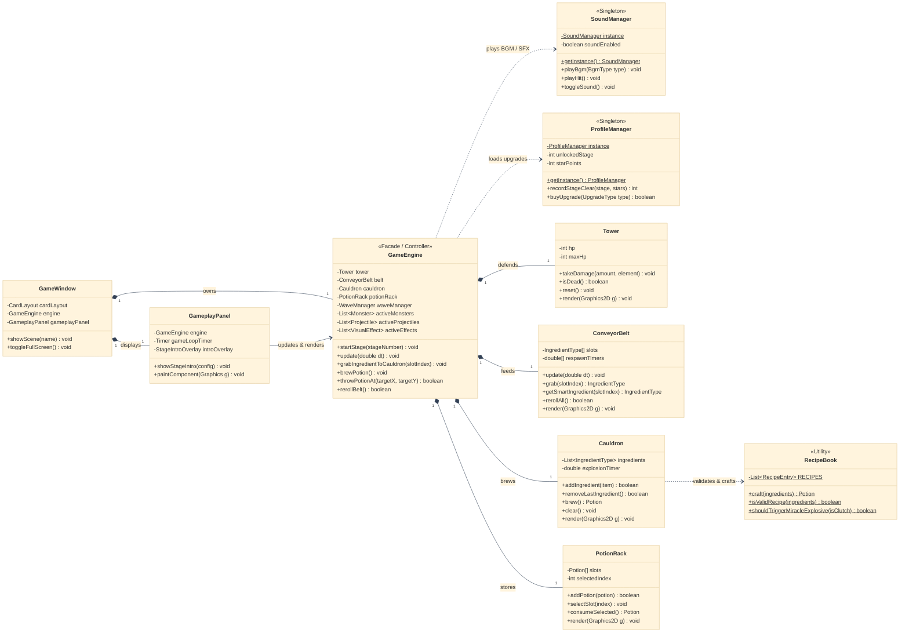
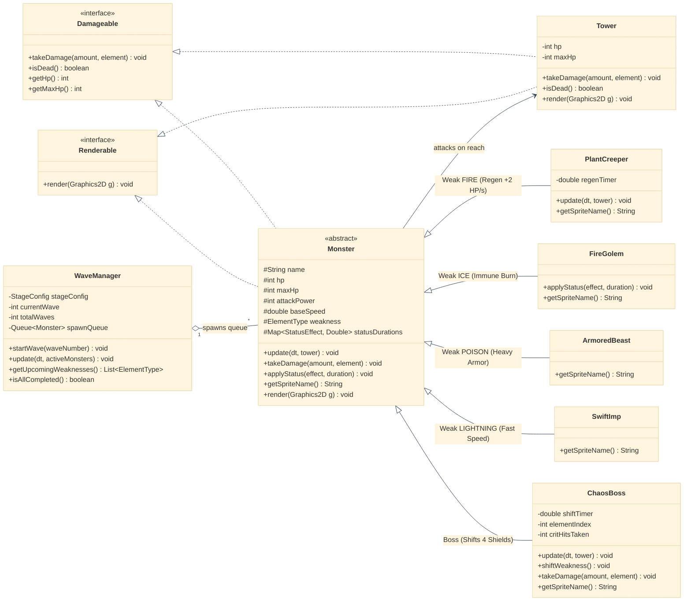
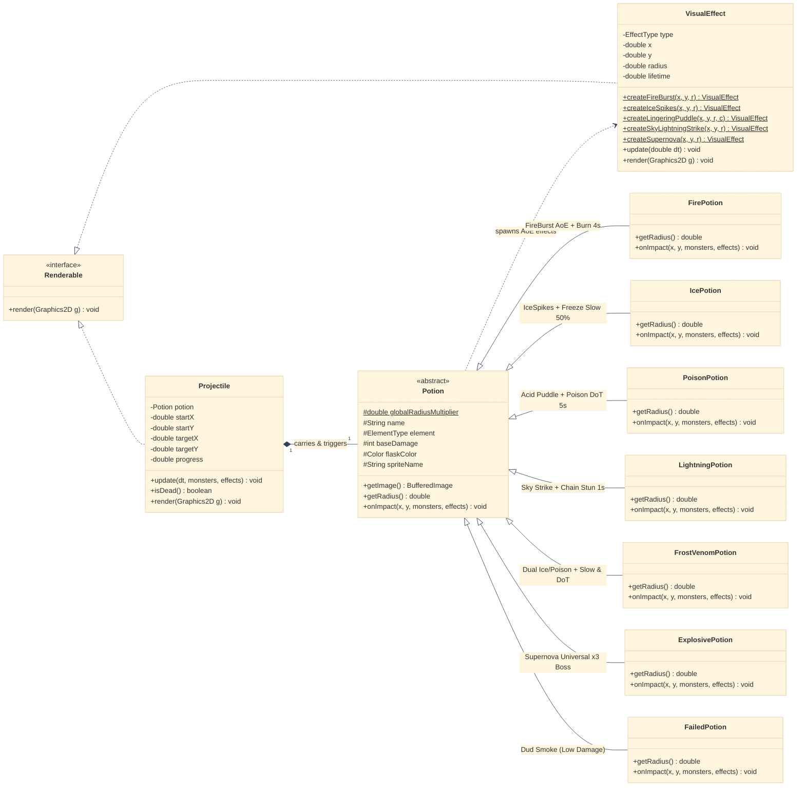

# POTION PANIC - แผนภาพ Class Diagram ฉบับแยก 3 ส่วนเชื่อมโยงสมบูรณ์ (100% True-to-Code & Modular Mermaid)

รวมโค้ด Mermaid Syntax แบบแยกเป็น 3 แผนภาพย่อยตามสถาปัตยกรรมและหลักการ OOP ที่ถูกต้องตรงตามซอร์สโค้ดเกมจริง 100% แสดงความเชื่อมโยงระหว่างระบบครบวงจร ออกแบบในทิศทางแนวนอน (`direction LR`) และลงสีสันสวยงาม อ่านง่าย ชัดเจน 100% ไม่มีปัญหาเรื่อง Parser หรือขอบตัวอักษรแหว่ง

---

## 🎨 แผนภาพที่ 1: สถาปัตยกรรมระบบหลัก หน้าจอ GUI และความสัมพันธ์แบบประกอบ (Core Engine, UI & Composition)
> **วางในรายงาน:** บทที่ 2 หัวข้อ **Composition (การประกอบ Has-A)**, **Encapsulation**, และ **Singleton Pattern**  
> **แนวคิด:** แสดงลำดับชั้นตั้งแต่หน้าต่างแสดงผล (`GameWindow`, `GameplayPanel`) ควบคุมเอนจินเกม (`GameEngine`) ซึ่งประกอบขึ้นจาก (`*--`) อุปกรณ์บนโต๊ะปรุงยา (`Tower`, `ConveyorBelt`, `Cauldron`, `PotionRack`) การเรียกใช้ตำราสูตรยา (`RecipeBook`) และคลาสผู้จัดการระดับโลกแบบ Singleton (`SoundManager`, `ProfileManager`)

---

## 🎨 แผนภาพที่ 2: ระบบปล่อยเวฟ อินเทอร์เฟซ และสายการสืบทอดมอนสเตอร์ (WaveManager, Interfaces & Monster Inheritance)
> **วางในรายงาน:** บทที่ 2 หัวข้อ **Abstraction (อินเทอร์เฟซและคลาสนามธรรม)** และ **Inheritance (การสืบทอดคุณสมบัติ)**  
> **แนวคิด:** เชื่อมต่อจาก `GameEngine` ผ่าน `WaveManager` และ `Tower` เพื่อแสดงการ Implement อินเทอร์เฟซ `Damageable` และ `Renderable` และแสดงคลาสแม่ `Monster` สืบทอดไปยังมอนสเตอร์ทั้ง 5 ชนิด พร้อมเมธอดที่ Override จริงในโค้ด

---

## 🎨 แผนภาพที่ 3: ระบบวิถีขวดยา เอฟเฟกต์สนามรบ และสายพหุสัณฐานขวดยาเวทมนตร์ (Projectile, VisualEffect & Potion Polymorphism)
> **วางในรายงาน:** บทที่ 2 หัวข้อ **Polymorphism (พหุสัณฐาน)** และ **Dynamic Method Dispatch**  
> **แนวคิด:** เชื่อมต่อจาก `GameEngine` ผ่าน `Projectile` และ `VisualEffect` แสดงการทำงานร่วมกันเมื่อขวดยาตกกระทบพื้นสนามรบ และแสดงคลาสแม่ `Potion` สืบทอดไปยังคลาสลูกขวดยาครบทั้ง 7 ชนิดตามโค้ดจริง

