# รายงานฉบับสมบูรณ์ (Final Project Report)
## วิชา การเขียนโปรแกรมเชิงวัตถุ (Object-Oriented Programming)

---

### - ชื่อ Project
**POTION PANIC (อลวนคนปรุงยา)**  
*A 2D Real-Time Crafting & Tower Defense Strategy Game*

**ข้อมูลผู้จัดทำ:**  
- **ชื่อ-นามสกุล:** นายปภาวิน โกการัตน์  
- **รหัสนักศึกษา:** 6804062612366  
- **ตอนเรียน (Section):** 3  
- **สาขาวิชา:** วิทยาการคอมพิวเตอร์ / เทคโนโลยีสารสนเทศ  
- **สถาบัน:** มหาวิทยาลัยเทคโนโลยีพระจอมเกล้าพระนครเหนือ (KMUTNB)  
- **ลิงก์คลังโค้ด (GitHub Repository):** https://github.com/s6804062612366-web/POTION-PANIC-GAME  

---

# บทที่ 1: บทนำ

### 1.1 ที่มาและความสำคัญของโปรเจ็ค
ในยุคปัจจุบัน วิดีโอเกมไม่ได้เป็นเพียงสื่อเพื่อความบันเทิงเท่านั้น แต่ยังเป็นเครื่องมือสำคัญในการฝึกทักษะการคิดวิเคราะห์ การตัดสินใจภายใต้สถานการณ์กดดัน และการทำงานแบบคู่ขนาน (Multitasking) อีกทั้งในการศึกษาวิทยาการคอมพิวเตอร์ การพัฒนาเกมยังเป็นแบบฝึกหัดที่ยอดเยี่ยมและท้าทายที่สุดในการประยุกต์ใช้แนวคิด **การเขียนโปรแกรมเชิงวัตถุ (Object-Oriented Programming: OOP)** เนื่องจากระบบเกมจำเป็นต้องมีการจำลองวัตถุที่มีสถานะ (State) และพฤติกรรม (Behavior) จำนวนมากที่ต้องปฏิสัมพันธ์กันตลอดเวลาในทุกๆ เสี้ยววินาที (Game Loop)

โครงการ **POTION PANIC (อลวนคนปรุงยา)** ได้รับแรงบันดาลใจจากการผสมผสานจุดเด่นของเกม 2 รูปแบบเข้าด้วยกัน คือ เกมแนวจัดการทรัพยากรและปรุงอาหาร (Time-Management & Crafting) เช่น *Overcooked* เข้ากับเกมแนวป้องกันฐาน (Tower Defense) โดยผู้เล่นจะได้รับบทบาทเป็น "ศิษย์ฝึกหัดนักปรุงยา" ผู้ต้องเข้าเวรเฝ้าหอคอยเวทมนตร์ยามค่ำคืน แต่เกิดเหตุการณ์ประตูมิติโบราณเปิดออก ทำให้ฝูงมอนสเตอร์หลากธาตุบุกทะลักเข้ามา ขณะเดียวกันสายพานลำเลียงวัตถุดิบใต้ดินเกิดขัดข้องและส่งสมุนไพรแร่ธาตุขึ้นมาอย่างต่อเนื่อง ผู้เล่นจึงต้องใช้ความจำ ไหวพริบ และความรวดเร็วในการผสมวัตถุดิบ 3 ชิ้นตามตำราเวทมนตร์ เพื่อสกัดกั้นและทำลายมอนสเตอร์รวมถึงบอสใหญ่ก่อนที่หอคอยจะพังทลาย

โครงงานนี้จึงถูกสร้างขึ้นเพื่อเป็นเครื่องพิสูจน์การนำทฤษฎี OOP ทั้ง 4 เสาหลัก (Encapsulation, Inheritance, Polymorphism, Abstraction) และ Design Patterns มาประยุกต์สร้างเป็นซอฟต์แวร์เกมที่ทำงานได้จริงอย่างสมบูรณ์ ลื่นไหล และมีสุนทรียภาพ

---

### 1.2 ประเภทของโครงการ
- **ประเภทซอฟต์แวร์:** ซอฟต์แวร์เกมเดสก์ท็อป 2 มิติ (2D Standalone Desktop Application)
- **ภาษาโปรแกรมหลัก:** ภาษา **Java (JDK 21)**
- **ชุดเครื่องมือกราฟิกและอินเทอร์เฟซ (GUI):** **Java Swing & Java AWT (Graphics2D Hybrid Engine)**
- **ระบบสถาปัตยกรรมสินทรัพย์ดิจิทัล (Asset Pipeline):** ทรัพยากรภาพความละเอียดสูง 2D Cel-Shaded (`AssetLoader`) ควบคู่กับระบบสำรองเวกเตอร์เรขาคณิต (`VectorArtRenderer`)
- **ระบบเสียงดนตรีประกอบ:** เครื่องยนต์สังเคราะห์คลื่นเสียง 16-bit หลายแทร็กโพลีโฟนิก (`SoundManager Polyphonic Synthesizer Engine`)
- **การจัดการโครงการและบิลด์:** **Apache Maven**
- **ระบบควบคุมเวอร์ชัน:** **Git & GitHub**

---

### 1.3 ประโยชน์
1. **ฝึกทักษะการแยกประสาทและการทำงานหลายอย่างพร้อมกัน (Multitasking Skills):** ผู้เล่นต้องสังเกตสายพานวัตถุดิบ กดเลือกวัตถุดิบลงหม้อต้ม ควบคุมการผสมยา และใช้เมาส์เล็งปาขวดยาใส่ศัตรูไปพร้อมกันในแบบเรียลไทม์
2. **พัฒนาทักษะการคิดวิเคราะห์และการวางแผนเชิงกลยุทธ์ (Strategic Thinking):** ผู้เล่นต้องวิเคราะห์จุดอ่อนของมอนสเตอร์แต่ละประเภทอย่างเฉียบขาด และตัดสินใจเลือกผสมยาชนิดที่เหมาะสมเพื่อสร้างความเสียหายสูงสุด (Critical Hit 2.5 เท่า)
3. **ฝึกความจำและการตอบสนองอย่างรวดเร็ว (Memory & Reflexes):** ผู้เล่นต้องจดจำสูตรการปรุงยาตำรา 3 วัตถุดิบ (2 ฐาน + 1 ตัวเร่ง หรือ ผสม 3 ธาตุ) ผ่านสมการไอคอนภาพ และตอบสนองต่อคลื่นศัตรูที่เคลื่อนที่เร็ว
4. **ความบันเทิงและสุนทรียภาพทางศิลปะ (Aesthetic & Game Feel):** นำเสนองานศิลปะแฟนตาซี 2 มิติโทนอบอุ่น ระบบอนิเมชันพาราโบลา ละอองฟิสิกส์ และระบบเสียงดนตรีประกอบที่ช่วยผ่อนคลายและสร้างความตื่นเต้น
5. **ประโยชน์เชิงวิชาการ:** เป็นตัวอย่างการประยุกต์ใช้แนวคิด OOP ขั้นสูงเข้ากับระบบซอฟต์แวร์จริง เช่น การจัดการหน่วยความจำ, Game Loop, Event Dispatch Thread, และการออกแบบสถาปัตยกรรมแบบ Modular

---

### 1.4 ขอบเขตของโครงการ (แนบ Proposal)

> **[ส่วนสำหรับแนบเอกสารข้อเสนอโครงการ (Proposal) ฉบับจริง]**  
> *สามารถคัดลอกข้อความ Proposal ดั้งเดิมที่เคยเสนออาจารย์ในชั้นเรียนมาวางทับในกรอบนี้ได้ หรือใช้ข้อกำหนดขอบเขตโครงการฉบับสมบูรณ์ด้านล่างนี้:*

โครงการได้กำหนดขอบเขตของการพัฒนาทั้งในเชิงระบบและเชิงเนื้อหาไว้ดังนี้:

1. **ขอบเขตด้านระบบเกมเพลย์ (Core Gameplay Loop):**
   - **ระบบสายพานลำเลียง (Conveyor Belt):** มี 5 ช่องวัตถุดิบ พร้อมระบบสุ่มอัจฉริยะตามภัยคุกคาม (Smart Threat-Aware Spawning System) และปุ่ม Reroll สุ่มใหม่ทั้งสายพาน (กด [F]) คูลดาวน์ 1.0 วินาที
   - **ระบบหม้อปรุงยา 3 วัตถุดิบ (3-Ingredient Cauldron):** ผสมวัตถุดิบ 3 ชิ้น พร้อมระบบคาถาชี้แนะอัจฉริยะ (Smart Recipe Helper) แสดงผลลัพธ์ที่จะได้เมื่อใส่ของครบ 2 ชิ้น
   - **ระบบแท่นพักขวดยา (Potion Rack):** เก็บขวดยาพร้อมใช้ได้ 4 ช่อง พร้อมคีย์ลัด [Q], [W], [E], [R] และระบบ Auto-Select ขวดยาใบใหม่ทันที
   - **ระบบหอคอยเวทมนตร์ (Magic Tower):** มีพลังชีวิตสูงสุด 100 HP พร้อมระบบเตือนภัยหน้าจอสั่นสะเทือนเมื่อเข้าสู่สภาวะวิกฤต (เลือด < 35%) และเสียงไซเรนเตือนภัย
   - **ระบบเอฟเฟกต์ภาพและฟิสิกส์ (Visual Effects Engine):** วิถีขวดยาโค้งพาราโบลาพร้อมหางละอองเวทมนตร์ตามธาตุ (Particle Trail), ออร่าเรืองแสง, วงแหวนล็อกเป้าหมาย (Target Ring), และเอฟเฟกต์การระเบิดเฉพาะธาตุ 5 ชนิด
2. **ขอบเขตด้านเนื้อหาและการดำเนินเรื่อง (Content & Stages):**
   - **ด่านการเล่น 4 ด่าน (3 ด่านเนื้อเรื่อง + 1 ด่าน Endless):**
     - *ด่านที่ 1 (Apprentice):* วัตถุดิบ 2 ชนิด เรียนรู้ธาตุไฟและน้ำแข็ง
     - *ด่านที่ 2 (Acid & Armor):* เพิ่มเห็ดพิษและมอนสเตอร์เกราะหนา
     - *ด่านที่ 3 (Storm & Chaos):* วัตถุดิบครบ 4 ชนิด พร้อมบอสใหญ่ ราชันย์อสูรเวท (Chaos Overlord)
     - *ด่านที่ 4 (Endless Mode):* โหมดเอาชีวิตรอดไม่รู้จบเพื่อสะสมคะแนนสูงสุด
   - **มอนสเตอร์ 5 ประเภท:** อสูรพฤกษา (แพ้ไฟ), โกเลมไฟ (แพ้น้ำแข็ง), สัตว์ร้ายเกราะหิน (แพ้กรดพิษ), อิมป์ว่องไว (แพ้สายฟ้า), และราชันย์อสูรเวท (บอสใหญ่สลับเกราะ 4 ธาตุ)
   - **ขวดยา 7 ชนิด:** ยาเพลิง, ยาน้ำแข็ง, ยากรดพิษ, ยาสายฟ้า, ยาหมอกพายุพิษ (Frost-Venom), ยาระเบิดมหาเวท (Universal Explosive - ไอเทมแรร์ Miracle Brew สุ่มออก 15-25%), และยาล้มเหลว (Failed Potion)
3. **ขอบเขตด้านกราฟิก เสียง และความเข้ากันได้:**
   - รองรับโหมดเต็มจอ (F11) และการปรับขนาดหน้าต่างแบบ Responsive รักษาสัดส่วน 16:9 (Letterboxing)
   - ระบบเสียงดนตรีประกอบสังเคราะห์แบบ Multi-Track ปิด/เปิดเสียงได้ทันทีด้วยปุ่ม [M]
   - ยึดหลัก **Zero-Emoji Policy** ไม่ใช้อีโมจิใดๆ ในระบบเพื่อความเข้ากันได้ของทุกระบบปฏิบัติการ

---

# บทที่ 2: ส่วนการพัฒนา

### 2.1 เนื้อเรื่องย่อหรือวิธีการเล่น (กรณีเกมส์)

#### เนื้อเรื่องย่อ (Story Synopsis)
ในคืนเดือนดับ ณ ยอดหอคอยเวทมนตร์โบราณอันเงียบสงบ "ศิษย์ฝึกหัดนักปรุงยา" ผู้ไร้พลังเวทมนตร์ต่อสู้โดยตรง ได้รับมอบหมายให้เฝ้าหอคอยเพียงลำพัง ทว่ารอยแยกมิติแห่งความโกลาหลกลับเปิดออก ปลดปล่อยกองทัพมอนสเตอร์บรรพกาลนำโดย "ราชันย์อสูรเวท (Chaos Overlord)" เข้าบดขยี้หอคอย ขณะเดียวกัน สายธารเวทมนตร์ใต้พิภพเกิดความปั่นป่วน สูบเอาสมุนไพรและแร่ธาตุทะลักขึ้นมาตามสายพานลำเลียงอย่างบ้าคลั่ง ทางรอดเดียวของศิษย์ฝึกหัดคือการตั้งสติ ใช้ภูมิปัญญาจากตำราเวทมนตร์ หยิบวัตถุดิบ 3 ชิ้น ต้มผสมยาตามจุดอ่อนของศัตรู แล้วขว้างระเบิดสกัดกั้นก่อนที่หอคอยเวทมนตร์จะพังทลายลง

#### วิธีการเล่นและการควบคุม (Controls & Game Mechanics)

| การกระทำ (Action) | ปุ่มควบคุม (Key / Mouse) | คำอธิบายรายละเอียด |
|---|---|---|
| **ดึงวัตถุดิบลงหม้อ** | กดปุ่มตัวเลข `1`, `2`, `3`, `4`, `5` | ดึงวัตถุดิบจากสายพานช่องที่ 1 ถึง 5 ลงหม้อต้มยา (ช่องนั้นจะเสกของใหม่มาแทนที่อัตโนมัติ) |
| **สุ่มของใหม่ทั้งสายพาน (Reroll)** | กดปุ่ม `F` | ล้างและสุ่มวัตถุดิบใหม่ทั้ง 5 ช่องบนสายพานทันที (คูลดาวน์ 1.0 วินาที พร้อมการันตีสูตรแก้ทางศัตรูตัวหน้าสุด) |
| **ต้มผสมยา (Brew Potion)** | กดปุ่ม `Spacebar` | ผสมยาเมื่อใส่ของครบ 3 ชิ้น (มีระบบคาถาชี้แนะรูปภาพแสดงขึ้นเมื่อใส่ครบ 2 ชิ้น) |
| **ดึงวัตถุดิบออกจากหม้อ** | กดปุ่ม `Backspace` | นำวัตถุดิบชิ้นล่าสุดออกจากหม้อ หรือกดล้างหม้อที่ระเบิดควัน |
| **ล้างหม้อต้มทั้งหมด** | กดปุ่ม `C` | เทวัตถุดิบทั้งหมดในหม้อทิ้งทันที |
| **เลือกขวดยาพร้อมใช้** | กดปุ่ม `Q`, `W`, `E`, `R` หรือ **คลิกเมาส์** | สลับเลือกช่องพักยาที่ 1 ถึง 4 บนแท่นวางยา |
| **เล็งและปาขวดยา** | เลื่อนเมาส์ไปยังเลนมอนสเตอร์ แล้ว **คลิกซ้าย** | เล็งวงรัศมีระเบิด (AoE Radius Circle) แล้วขว้างยาไปยังจุดตกกระทบ |
| **เปิด/ปิด สมุดตำราสูตรยา** | กดปุ่ม `Tab` หรือ `H` | เปิดตำราเวทมนตร์ดูสูตรยา 3 วัตถุดิบและข้อมูลจุดอ่อนมอนสเตอร์ |
| **เปิด/ปิดเสียง (Mute Toggle)** | กดปุ่ม `M` | สลับเปิด/ปิดเสียงเพลง BGM และเสียงเอฟเฟกต์ทั้งหมดทันที |
| **เลื่อนการ์ดสอนสูตรก่อนเริ่มด่าน** | กดปุ่ม `A` / `D` หรือ `ลูกศรซ้าย/ขวา` | พลิกดูข้อมูลมอนสเตอร์หน้า 1 และสมการสูตรยาหน้า 2 |
| **สลับโหมดเต็มหน้าจอ** | กดปุ่ม `F11` | สลับระหว่างโหมดหน้าต่างปกติและโหมดเต็มจอ (Fullscreen Responsive) |
| **กลับสู่เมนูหลัก** | กดปุ่ม `Esc` | ย้อนกลับสู่หน้าจอเมนูหลักของเกม |

---

### 2.2 คลาสไดอะแกรมการพัฒนา พร้อมคำอธิบาย

#### แผนภาพคลาสไดอะแกรม (Mermaid Class Diagram)

```mermaid
classDiagram
    %% Core Interfaces
    class Renderable {
        <<interface>>
        +render(Graphics2D g)*
    }
    class Updatable {
        <<interface>>
        +update(double dt)*
    }
    class Damageable {
        <<interface>>
        +takeDamage(int amount, ElementType element)*
        +isDead() boolean*
        +getHp() int*
        +getMaxHp() int*
    }

    %% Base Entities
    class Tower {
        -int hp
        -int maxHp
        -int x
        -int y
        +takeDamage(int amount, ElementType element)
        +reset()
    }

    class Monster {
        <<abstract>>
        #double x
        #double y
        #double speed
        #int hp
        #int maxHp
        #ElementType weakness
        #int attackPower
        +update(double dt, Tower tower)
        +takeDamage(int amount, ElementType element)
    }

    class Potion {
        <<abstract>>
        #String name
        #ElementType element
        #int baseDamage
        #Color flaskColor
        +onImpact(double impactX, double impactY, List~Monster~ monsters, List~VisualEffect~ effects)*
        +getRadius() double
    }

    %% Monster Subclasses (Inheritance & Polymorphism)
    class FireGolem {
        +FireGolem(double x, double y)
    }
    class PlantCreeper {
        +PlantCreeper(double x, double y)
    }
    class ArmoredBeast {
        +ArmoredBeast(double x, double y)
    }
    class SwiftImp {
        +SwiftImp(double x, double y)
    }
    class ChaosBoss {
        -double shiftTimer
        +takeDamage(int amount, ElementType element)
        +update(double dt, Tower tower)
    }

    %% Potion Subclasses (Inheritance & Polymorphism)
    class FirePotion {
        +onImpact(...)
    }
    class IcePotion {
        +onImpact(...)
    }
    class PoisonPotion {
        +onImpact(...)
    }
    class LightningPotion {
        +onImpact(...)
    }
    class FrostVenomPotion {
        +onImpact(...)
    }
    class ExplosivePotion {
        +onImpact(...)
    }
    class FailedPotion {
        +onImpact(...)
    }

    %% Items & Composition
    class ConveyorBelt {
        -IngredientType[] slots
        +grab(int index) IngredientType
        +update(double dt, ...)
        +rerollAll(...) boolean
    }
    class Cauldron {
        -List~IngredientType~ ingredients
        +addIngredient(IngredientType item) boolean
        +brew() Potion
    }
    class PotionRack {
        -Potion[] slots
        -int selectedIndex
        +addPotion(Potion potion) boolean
        +consumeSelected() Potion
    }

    %% Engine & Singletons
    class GameEngine {
        -Tower tower
        -ConveyorBelt belt
        -Cauldron cauldron
        -PotionRack potionRack
        -WaveManager waveManager
        -List~Monster~ activeMonsters
        -List~Projectile~ activeProjectiles
        -List~VisualEffect~ activeEffects
        +update(double dt)
        +throwPotionAt(double x, double y) boolean
    }
    class SoundManager {
        <<singleton>>
        -static SoundManager instance
        +playBattleBgm()
        +stopBgm()
        +toggleSound()
    }
    class ProfileManager {
        <<singleton>>
        -static ProfileManager instance
        +getStars() int
        +upgradeSkill(String skillId) boolean
    }

    %% Relationships
    Damageable <|.. Tower
    Renderable <|.. Tower
    Damageable <|.. Monster
    Renderable <|.. Monster
    Renderable <|.. Potion
    Renderable <|.. ConveyorBelt
    Renderable <|.. Cauldron
    Renderable <|.. PotionRack

    Monster <|-- FireGolem
    Monster <|-- PlantCreeper
    Monster <|-- ArmoredBeast
    Monster <|-- SwiftImp
    Monster <|-- ChaosBoss

    Potion <|-- FirePotion
    Potion <|-- IcePotion
    Potion <|-- PoisonPotion
    Potion <|-- LightningPotion
    Potion <|-- FrostVenomPotion
    Potion <|-- ExplosivePotion
    Potion <|-- FailedPotion

    GameEngine *-- Tower
    GameEngine *-- ConveyorBelt
    GameEngine *-- Cauldron
    GameEngine *-- PotionRack
    GameEngine o-- Monster
    GameEngine o-- Potion
```


#### คำอธิบายความสัมพันธ์ในคลาสไดอะแกรม:
1. **Interface Realization (การปฏิบัติตามสัญญาอินเทอร์เฟซ):**
   - `Tower` และ `Monster` ปฏิบัติตามอินเทอร์เฟซ `Damageable` (รับดาเมจได้) และ `Renderable` (วาดภาพลงกราฟิกได้) ทำให้ Game Loop สามารถสั่งอัปเดตและเรนเดอร์ออบเจกต์ได้อย่างเป็นเอกภาพ
2. **Inheritance & Polymorphism (การสืบทอดและพหุสัณฐาน):**
   - `Monster` เป็นคลาสแม่นามธรรม (Abstract Class) ที่มีคลาสลูก 5 ตัว โดย `ChaosBoss` ทำการ Override เมธอด `takeDamage()` และ `update()` เพื่อเพิ่มกลไกการสลับเกราะ 4 ธาตุ
   - `Potion` เป็นคลาสแม่นามธรรมที่มีคลาสลูก 7 ตัว โดยทุกคลาสต้อง Override เมธอด `onImpact()` เพื่อสร้างเอฟเฟกต์เฉพาะธาตุของตนเอง
3. **Composition (การประกอบวัตถุ):**
   - `GameEngine` ทำหน้าที่เป็นผู้ประสานงานหลัก โดยประกอบขึ้นจากออบเจกต์ `Tower`, `ConveyorBelt`, `Cauldron`, และ `PotionRack` ซึ่งทำงานร่วมกันแบบ Has-A Relationship
4. **Singleton Pattern:**
   - `SoundManager` และ `ProfileManager` ถูกออกแบบเป็น Singleton เพื่อให้ระบบเสียงและการบันทึกข้อมูลคะแนน/ดาว สามารถเข้าถึงได้จากทุกหน้าจอโดยมี Instance เพียงหนึ่งเดียวในระบบ

---

### 2.3 รูปแบบ Application / Applet

โครงการ **POTION PANIC** พัฒนาขึ้นในรูปแบบ **Standalone Desktop Application** (สร้างด้วย Java Swing & AWT) โดยไม่ได้ใช้รูปแบบ Java Applet

#### การเปรียบเทียบและการตัดสินใจเลือกเชิงสถาปัตยกรรม:
1. **Desktop Application (รูปแบบที่เลือกใช้):**
   - มีจุดเริ่มต้นการทำงาน (Entry Point) ผ่านเมธอด `public static void main(String[] args)` ในคลาส [Main.java](file:///Users/kokarat/Desktop/POTION_PANIC_OOP/src/main/java/com/potionpanic/Main.java)
   - รันอยู่บน Java Virtual Machine (JVM) โดยตรง ทำให้สามารถเข้าถึงฮาร์ดแวร์เร่งความเร็วของกราฟิก (Hardware-Accelerated Java2D), ระบบเสียงสังเคราะห์ผ่าน `javax.sound.sampled.SourceDataLine`, และการจัดการหน้าต่างแบบ Fullscreen ได้อย่างเต็มประสิทธิภาพ
   - มีความปลอดภัย เสถียรภาพสูง และสามารถแพ็กเกจเป็นไฟล์ Executable JAR (`PotionPanic.jar`) ดับเบิลคลิกเล่นได้บนทุกระบบปฏิบัติการ
2. **Java Applet (เหตุผลที่ไม่เลือกใช้):**
   - ในอดีต Applet ถูกออกแบบมาเพื่อรันอยู่ภายในเว็บเบราว์เซอร์ผ่านคลาส `java.applet.Applet` หรือ `javax.swing.JApplet`
   - **ข้อจำกัดเชิงเทคโนโลยี:** บริษัท Oracle ได้ประกาศ Deprecated เทคโนโลยี Applet ตั้งแต่ Java SE 9 และได้ทำการ **ตัดออกจากชุดภาษา Java อย่างถาวรตั้งแต่ Java SE 11 เป็นต้นมา** เนื่องจากปัญหาด้านช่องโหว่ความปลอดภัย (Security Vulnerabilities) และเว็บเบราว์เซอร์ยุคใหม่ทั้งหมด (Chrome, Edge, Safari, Firefox) ได้ยกเลิกการรองรับ NPAPI Plugin ไปแล้ว
   - ดังนั้น การพัฒนาในรูปแบบ **Desktop Application บน Java 21** จึงเป็นมาตรฐานที่ถูกต้อง ทันสมัย และสอดคล้องกับแนวทางการพัฒนาซอฟต์แวร์ระดับสากล

---

### 2.4 อธิบายส่วนของโปรแกรมที่มี

#### 1. Constructor (คอนสตรัคเตอร์)
คอนสตรัคเตอร์คือเมธอดพิเศษที่มีชื่อตรงกับชื่อคลาส ทำหน้าที่กำหนดค่าเริ่มต้น (Initialization) ให้กับสถานะของออบเจกต์ทันทีที่ถูกสร้างด้วยคีย์เวิร์ด `new` ช่วยป้องกันข้อผิดพลาด NullPointerException และรับประกันความสมบูรณ์ของข้อมูล

*ตัวอย่างโค้ดในโปรเจกต์ ([ChaosBoss.java](file:///Users/kokarat/Desktop/POTION_PANIC_OOP/src/main/java/com/potionpanic/entity/monster/ChaosBoss.java)):*
```java
public class ChaosBoss extends Monster {
    private double shiftTimer = 0.0;
    private final double SHIFT_INTERVAL = 7.5; // สลับเกราะทุก 7.5 วินาที

    public ChaosBoss(double startX, double startY) {
        // เรียก Constructor ของคลาสแม่ (Monster) ด้วยคำสั่ง super
        // กำหนดเลือด 420, ความเร็ว 0.28, พลังโจมตี 25, จุดอ่อนเริ่มต้นที่ธาตุไฟ
        super("ราชันย์อสูรเวท (Chaos Overlord)", 420, 0.28, 25, ElementType.FIRE, startX, startY);
        this.width = 96;
        this.height = 96;
    }
}
```

---

#### 2. Encapsulation (การห่อหุ้มข้อมูล)
การห่อหุ้มข้อมูลคือการจำกัดสิทธิ์การเข้าถึงข้อมูลสถานะภายในออบเจกต์ โดยประกาศฟิลด์เป็น `private` และเปิดให้ภายนอกเข้าถึงหรือแก้ไขได้เฉพาะผ่านเมธอด `Getter` และ `Setter` เท่านั้น ซึ่งเปิดโอกาสให้สามารถใส่เงื่อนไขตรวจสอบความถูกต้องของข้อมูล (Validation) ป้องกันไม่ให้ค่าสถานะของระบบเสียหาย

*ตัวอย่างโค้ดในโปรเจกต์ ([Tower.java](file:///Users/kokarat/Desktop/POTION_PANIC_OOP/src/main/java/com/potionpanic/entity/Tower.java)):*
```java
public class Tower implements Damageable, Renderable {
    private int hp;
    private int maxHp;

    public Tower(int maxHp) {
        this.maxHp = maxHp;
        this.hp = maxHp;
    }

    @Override
    public void takeDamage(int amount, ElementType element) {
        // ควบคุมไม่ให้พลังชีวิตของหอคอยติดลบต่ำกว่า 0
        this.hp = Math.max(0, this.hp - amount);
    }

    public int getHp() { return hp; }
    public int getMaxHp() { return maxHp; }
    
    public void setMaxHp(int maxHp) {
        if (maxHp > 0) { // ตรวจสอบความถูกต้องของข้อมูล
            this.maxHp = maxHp;
        }
    }
}
```

---

#### 3. Composition (การประกอบวัตถุ)
การสร้างคลาสขนาดใหญ่โดยประกอบขึ้นจากออบเจกต์ของคลาสย่อยๆ ที่มีความรับผิดชอบเฉพาะทาง (Has-A Relationship) เพื่อลดความซ้ำซ้อนและแยกหน้าที่การทำงานอย่างชัดเจนตามหลัก Single Responsibility Principle

*ตัวอย่างโค้ดในโปรเจกต์ ([GameEngine.java](file:///Users/kokarat/Desktop/POTION_PANIC_OOP/src/main/java/com/potionpanic/engine/GameEngine.java)):*
```java
public class GameEngine {
    // GameEngine "ประกอบด้วย (Has-A)" หอคอย, สายพาน, หม้อต้ม, และแท่นวางยา
    private final Tower tower;
    private final ConveyorBelt belt;
    private final Cauldron cauldron;
    private final PotionRack potionRack;
    private final WaveManager waveManager;
    private final List<Monster> activeMonsters = new ArrayList<>();
    private final List<Projectile> activeProjectiles = new ArrayList<>();
    private final List<VisualEffect> activeEffects = new ArrayList<>();

    public GameEngine() {
        this.tower = new Tower(Constants.TOWER_MAX_HP);
        this.belt = new ConveyorBelt();
        this.cauldron = new Cauldron(Constants.ZONE_BOT_X, Constants.ZONE_BOT_Y + 15);
        this.potionRack = new PotionRack(Constants.ZONE_BOT_X + 220, Constants.ZONE_BOT_Y + 15);
        this.waveManager = new WaveManager();
    }
}
```

---

#### 4. Polymorphism (ภาวะพหุสัณฐาน)
ความสามารถของออบเจกต์ในคลาสลูกต่างๆ ที่สืบทอดมาจากคลาสแม่เดียวกัน ในการตอบสนองต่อชื่อเมธอดเดียวกันด้วยพฤติกรรมเฉพาะตัวที่แตกต่างกันอย่างสิ้นเชิงผ่านการ Override เมธอด

*ตัวอย่างโค้ดในโปรเจกต์ (คลาสลูกของ [Potion.java](file:///Users/kokarat/Desktop/POTION_PANIC_OOP/src/main/java/com/potionpanic/entity/potion/Potion.java)):*
```java
// ในคลาสลูก FirePotion: ปะทุเป็นเสาเพลิงและติดสถานะเผาไหม้ (Burn)
public class FirePotion extends Potion {
    @Override
    public void onImpact(double impactX, double impactY, List<Monster> allMonsters, List<VisualEffect> effects) {
        effects.add(VisualEffect.createFireBurst(impactX, impactY, getRadius()));
        for (Monster m : allMonsters) {
            if (isInRadius(m, impactX, impactY)) {
                m.takeDamage(baseDamage, ElementType.FIRE);
                m.applyStatus(StatusEffect.BURN, 4.0);
            }
        }
    }
}

// ในคลาสลูก IcePotion: แผ่หนามน้ำแข็งและติดสถานะสโลว์แช่แข็ง (Freeze)
public class IcePotion extends Potion {
    @Override
    public void onImpact(double impactX, double impactY, List<Monster> allMonsters, List<VisualEffect> effects) {
        effects.add(VisualEffect.createIceSpikes(impactX, impactY, getRadius()));
        for (Monster m : allMonsters) {
            if (isInRadius(m, impactX, impactY)) {
                m.takeDamage(baseDamage, ElementType.ICE);
                m.applyStatus(StatusEffect.FREEZE, 4.0);
            }
        }
    }
}
```

---

#### 5. Abstract Class & Interface (คลาสนามธรรมและอินเทอร์เฟซ)
- **Interface (`Renderable`, `Damageable`):** ทำหน้าที่เป็นสัญญาข้อตกลง (Contract) ที่บังคับให้คลาสที่นำไปใช้ต้องเขียนการทำงานตามเมธอดที่ประกาศไว้
- **Abstract Class (`Monster`, `Potion`):** คลาสแม่ที่ไม่สามารถนำไป `new` เป็นออบเจกต์ได้โดยตรง ทำหน้าที่รวมฟิลด์และโค้ดพื้นฐานที่คลาสลูกใช้ร่วมกัน พร้อมประกาศ Abstract Method ให้คลาสลูกต้องนำไป Override

*ตัวอย่างโค้ดในโปรเจกต์ ([Monster.java](file:///Users/kokarat/Desktop/POTION_PANIC_OOP/src/main/java/com/potionpanic/entity/monster/Monster.java)):*
```java
public abstract class Monster implements Damageable, Renderable {
    protected double x, y, speed;
    protected int hp, maxHp;
    protected ElementType weakness;

    // คำนวณดาเมจธาตุจุดอ่อน (Critical 2.5 เท่า) และดาเมจต้านทาน (Resist 15%)
    @Override
    public void takeDamage(int amount, ElementType element) {
        if (element == ElementType.UNIVERSAL) {
            int finalDmg = (int)(amount * 1.5);
            this.hp = Math.max(0, this.hp - finalDmg);
        } else if (element == this.weakness) {
            int finalDmg = (int)(amount * 2.5); // จุดอ่อนโดน 2.5 เท่า
            this.hp = Math.max(0, this.hp - finalDmg);
        } else {
            int finalDmg = Math.max(1, (int)(amount * 0.15)); // ผิดธาตุโดนต้านทาน
            this.hp = Math.max(0, this.hp - finalDmg);
        }
    }
}
```

---

#### 6. Inheritance (การสืบทอดคุณสมบัติ)
การสืบทอดคุณสมบัติและพฤติกรรมจากคลาสแม่มาสู่คลาสลูกผ่านคีย์เวิร์ด `extends` ช่วยลดความซ้ำซ้อนของโค้ด (Code Reusability) ทำให้คลาสลูกเขียนเฉพาะส่วนที่เพิ่มเติมหรือแตกต่างจากคลาสแม่

*ตัวอย่างโค้ดในโปรเจกต์ ([SwiftImp.java](file:///Users/kokarat/Desktop/POTION_PANIC_OOP/src/main/java/com/potionpanic/entity/monster/SwiftImp.java)):*
```java
public class SwiftImp extends Monster {
    public SwiftImp(double x, double y) {
        // สืบทอดระบบเดิน หลอดเลือด แอนิเมชัน และฟิสิกส์จาก Monster ทั้งหมด
        // กำหนดความเร็วสูง 1.15 พลังโจมตี 12 และแพ้ธาตุสายฟ้า (LIGHTNING)
        super("อิมป์ว่องไว (Swift Imp)", 65, 1.15, 12, ElementType.LIGHTNING, x, y);
    }
}
```

---

### 2.5 หน้าจอ GUI อธิบายส่วนประกอบของ GUI โครงสร้างของ GUI ประกอบด้วย Component อะไรบ้าง

โครงสร้างหน้าจอ GUI ของเกมพัฒนาขึ้นโดยอาศัยโครงสร้างลำดับชั้นของ Java Swing (Hierarchical Component Tree):

```
[JFrame: GameWindow]
  └── [JPanel: rootPanel (ใช้ CardLayout)]
        ├── [MainMenuPanel]      : หน้าจอเมนูหลัก พร้อมไตเติลแอนิเมชันลอยตัว และปุ่มนำทาง
        ├── [StageSelectPanel]   : หน้าจอเลือกด่าน 4 ด่าน และร้านอัปเกรดสกิลเวทมนตร์ (Shop)
        ├── [GameplayPanel]      : หน้าจอเล่นเกมหลัก (Game Canvas เรนเดอร์ 60 FPS)
        │     └── [StageIntroOverlay] : หน้าต่างโมดอลการ์ดสอนสูตรก่อนเริ่มด่าน
        ├── [VictoryPanel]       : หน้าจอสรุปคะแนนและดวงดาวเมื่อชนะด่าน
        └── [GameOverPanel]      : หน้าจอแสดงผลเมื่อหอคอยแตก พร้อมคำแนะนำ
```

#### หน้าที่และส่วนประกอบสำคัญของแต่ละ Component:
1. **`GameWindow (JFrame)`:**
   - เป็น Container ชั้นนอกสุด ทำหน้าที่สร้างหน้าต่างขนาด 1280x720 พิกเซล
   - ควบคุมการสลับหน้าจอ (Scene Switching) ผ่าน `CardLayout`
   - จัดการการสลับโหมดเต็มหน้าจอ (Fullscreen Toggle F11) และการทำความสะอาดโปรเซสก่อนปิดโปรแกรม (`WindowAdapter`)
2. **`GameplayPanel (JPanel)`:**
   - คอมโพเนนต์หลักที่ทำหน้าที่เป็น Game Canvas โดย Override เมธอด `paintComponent(Graphics g)` และใช้ `Graphics2D` วาดภาพกราฟิกทั้งหมด
   - มีระบบ Game Loop ที่ควบคุมความเร็ว 60 เฟรมต่อวินาทีด้วย `javax.swing.Timer`
   - **การแบ่งโซนเรนเดอร์ 3 ส่วน (3-Zone Virtual Layout):**
     1. *Battlefield Zone (ด้านบน 0 - 360px):* พื้นหลังสนามรบหินโบราณ, หอคอยเวทมนตร์, การเดินของมอนสเตอร์ (จัดลำดับ Depth Sorting แกน Y), วงแหวนล็อกเป้าหมาย, และการบินของขวดยา
     2. *Conveyor Zone (ตรงกลาง 360 - 480px):* รางสายพานหินสลักอักขระรูน พร้อมช่องแสดงวัตถุดิบ 5 ช่อง และป้ายปุ่มลัด [1]-[5] และ [F]
     3. *Alchemy Station Zone (ด้านล่าง 480 - 720px):* โต๊ะทำงานไม้โอ๊ค, หม้อต้มยา 3 ช่องพร้อมคาถาชี้แนะรูปภาพ, แท่นพักยาวางขวดยา 4 ช่อง [Q]-[R], และกระดานสมการสูตรยาเร่งด่วน
3. **การแสดงผลแบบ Responsive Scaling ([ScaleHelper.java](file:///Users/kokarat/Desktop/POTION_PANIC_OOP/src/main/java/com/potionpanic/util/ScaleHelper.java)):**
   - คำนวณอัตราส่วน Scale และทำ Letterboxing (ขอบดำ) เพื่อให้กราฟิก ฟอนต์ และตำแหน่งคลิกเมาส์คงสัดส่วน 16:9 (1280x720) เสมอบนทุกขนาดหน้าจอ

---

### 2.6 อธิบาย Event handling ที่มีในหน้าจอ

ระบบรับส่งเหตุการณ์และการตอบสนองต่อผู้เล่นอาศัย Event Listeners ของ Java AWT/Swing:

1. **Keyboard Event Handling (`KeyAdapter` & `KeyEventDispatcher`):**
   - **Global Shortcuts (ดักจับผ่าน `KeyEventDispatcher` ใน `GameWindow`):**
     - `KeyEvent.VK_F11`: สลับโหมดเต็มจอ / หน้าต่างปกติได้จากทุกหน้าจอ
     - `KeyEvent.VK_M`: สลับเปิด/ปิดเสียงดนตรีประกอบและเสียงเอฟเฟกต์ทั้งหมด (Global Mute Toggle)
   - **Gameplay Shortcuts (ดักจับผ่าน `KeyAdapter` ใน `GameplayPanel`):**
     - `KeyEvent.VK_1` ถึง `VK_5`: สั่ง `GameEngine.grabIngredientToCauldron(index)` ดึงของจากสายพานลงหม้อ
     - `KeyEvent.VK_F`: สั่ง `GameEngine.rerollBelt()` ล้างสุ่มวัตถุดิบใหม่ทั้งสายพาน
     - `KeyEvent.VK_SPACE`: สั่ง `GameEngine.brewPotion()` ผสมยาในหม้อ หรือสั่งเริ่มด่านในหน้าการ์ดสอนสูตร
     - `KeyEvent.VK_BACK_SPACE`: นำวัตถุดิบชิ้นล่าสุดออกจากหม้อ หรือล้างควันเมื่อหม้อระเบิด
     - `KeyEvent.VK_C`: ล้างวัตถุดิบทั้งหมดในหม้อต้มทิ้งทันที
     - `KeyEvent.VK_Q, VK_W, VK_E, VK_R`: สลับเลือกช่องพักยาที่ 1 ถึง 4
     - `KeyEvent.VK_TAB, VK_H`: สลับเปิด/ปิด สมุดตำราเวทมนตร์ (Recipe Grimoire)
     - `KeyEvent.VK_A, VK_D, VK_LEFT, VK_RIGHT`: พลิกเปลี่ยนหน้าการ์ดสอนสูตรก่อนเริ่มด่าน
     - `KeyEvent.VK_ESCAPE`: หยุดเกมชั่วคราวหรือย้อนกลับสู่เมนูหลัก
2. **Mouse Event Handling (`MouseAdapter` & `MouseMotionAdapter`):**
   - **`mouseMoved(MouseEvent e)`:** แปลงพิกัดเมาส์จริงบนจอให้เป็นพิกัดเสมือน (Virtual Coordinates 1280x720) เพื่อใช้วาดวงเล็งเป้าหมายและรัศมีระเบิดบนสนามรบ
   - **`mousePressed(MouseEvent e)`:**
     - หากคลิกบนสายพานหรือปุ่มบนการ์ดสรุปข้อมูล: เรียกใช้คำสั่งตามปุ่มนั้น
     - หากคลิกบนสนามรบโซนบน: เรียกคำสั่ง `GameEngine.throwPotionAt(x, y)` เพื่อคำนวณวิถีโค้งและขว้างยาไปยังพิกัดที่คลิก

---

### 2.7 อธิบายอัลกอริทึมที่สำคัญในโปรแกรม

#### 1. อัลกอริทึมการตรวจสอบสูตรผสมยา 3 วัตถุดิบ (3-Ingredient Matching Algorithm)
ใน [RecipeBook.java](file:///Users/kokarat/Desktop/POTION_PANIC_OOP/src/main/java/com/potionpanic/item/RecipeBook.java) ตรวจสอบความถี่ของวัตถุดิบ 3 ชิ้นโดยไม่ขึ้นกับลำดับก่อนหลัง (Order-Independent Matching) ช่วยให้ผู้เล่นสามารถหยิบวัตถุดิบชิ้นใดลงก่อนก็ได้:
```java
Map<IngredientType, Integer> counts = countIngredients(ingredients);
int red = counts.getOrDefault(RED_HERB, 0);
int blue = counts.getOrDefault(BLUE_CRYSTAL, 0);
int poison = counts.getOrDefault(TOXIC_MUSHROOM, 0);
int thunder = counts.getOrDefault(THUNDER_ROOT, 0);

if (red == 2 && blue == 1) return new FirePotion();
else if (blue == 2 && red == 1) return new IcePotion();
else if (poison == 2 && red == 1) return new PoisonPotion();
else if (thunder == 2 && blue == 1) return new LightningPotion();
else if (poison == 1 && blue == 1 && red == 1) return new FrostVenomPotion();
else return new FailedPotion(); // สูตรไม่ถูกต้อง หม้อจะระเบิดควัน
```

#### 2. อัลกอริทึมการสุ่มวัตถุดิบอัจฉริยะตามภัยคุกคาม (Smart Threat-Aware Alchemy Spawning)
ใน [ConveyorBelt.java](file:///Users/kokarat/Desktop/POTION_PANIC_OOP/src/main/java/com/potionpanic/item/ConveyorBelt.java) อัปเกรดจากการสุ่มแบบทั่วไป เป็นระบบวิเคราะห์ภัยคุกคามแบบไดนามิก 3 ลำดับชั้น:
- **ลำดับที่ 1 (ตรวจจับภัยคุกคามหน้าสุด):** ตรวจจับมอนสเตอร์ตัวที่อยู่ใกล้หอคอยที่สุด ดึงสูตรยาที่ชนะทาง หากบนสายพานยังขาดวัตถุดิบตัวใด จะเร่งสุ่มชิ้นที่ขาดลงมาด้วยโอกาสสูงถึง 85%
- **ลำดับที่ 2 (เติมเต็มหม้อต้ม):** หากในหม้อต้มมีของแล้ว 1-2 ชิ้น ระบบจะเพิ่มโอกาสสุ่มวัตถุดิบชิ้นที่ 3 ที่จะทำให้ปรุงสำเร็จลงสายพาน 80%
- **ลำดับที่ 3 (การันตี Reroll 100%):** เมื่อกดปุ่ม [F] สายพานจะรับประกันการเสกวัตถุดิบครบ 3 ชิ้นสำหรับปรุงยาปราบศัตรูตัวหน้าสุดเสมอ ผู้เล่นจึงไม่ต้องเสียเวลารอสุ่มทิ้งซ้ำๆ

#### 3. อัลกอริทึมบอสและการสลับเกราะหมุนเวียน (Boss Shield Shifting & True Damage)
ใน [ChaosBoss.java](file:///Users/kokarat/Desktop/POTION_PANIC_OOP/src/main/java/com/potionpanic/entity/monster/ChaosBoss.java) บอสใหญ่จะสลับเกราะธาตุหมุนเวียน (ไฟ $\rightarrow$ น้ำแข็ง $\rightarrow$ พิษ $\rightarrow$ สายฟ้า) ทุกๆ 7.5 วินาที แต่หากผู้เล่นใช้ **ยาระเบิดมหาเวท (Universal Explosive)** โจมตี เกราะจะแตกสลายทันทีและได้รับดาเมจรุนแรงถึง 3 เท่า

#### 4. อัลกอริทึมของแรร์ยาระเบิดมหาเวท (Miracle Brew) และระบบเศรษฐกิจดาว
- **Miracle Brew:** เมื่อผู้เล่นปรุงยา 5 สูตรมาตรฐานสำเร็จ จะมีโอกาสสุ่มติดแจ็กพอตได้รับยาระเบิดมหาเวท 15% ในสถานการณ์ปกติ และเพิ่มเป็น 25% ในสถานการณ์คับขัน (HP หอคอย $\le 50\%$ หรือมีศัตรู $\ge 3$ ตัว)
- **Star Economy:** ปรับเพดานอัปเกรดเป็น 9 ดาว พอดีกับดาวสูงสุดจาก 3 ด่านหลัก (3 ด่าน x 3 ดาว = 9 ดาว) มีปุ่มรีเซ็ตสกิลคืนดาว 100% พร้อมโบนัสเล่นซ้ำ (+1 ดาว) และโบนัส Endless (+1 ดาว/2 เวฟ)

---

# บทที่ 3: สรุป

### 3.1 ปัญหาที่พบระหว่างการพัฒนา
1. **ปัญหามอนสเตอร์เดินทับซ้อนกันในเลนเดียวกัน (Sprite Overlapping):**
   - *ปัญหา:* มอนสเตอร์ที่เกิดพร้อมกันเดินทับแกน Y เดียวกัน ทำให้ภาพมอนสเตอร์ตัวเล็กถูกตัวใหญ่บดบัง
   - *วิธีแก้:* ใช้ระบบกระจายพิกัดเกิด (Staggered Spawning) ร่วมกับอัลกอริทึม Depth Sorting (เรียงลำดับวาดตัวที่ Y น้อยก่อน และตัวที่ Y มากวาดทับ) ทำให้ภาพมีมิติความลึกที่ถูกต้อง
2. **ปัญหาความไม่เข้ากันของอีโมจิและฟอนต์ระหว่างระบบปฏิบัติการ:**
   - *ปัญหา:* การใช้อีโมจิบน macOS บางครั้งแสดงผลเป็นสี่เหลี่ยมว่าง (Tofu) บน Windows
   - *วิธีแก้:* บังคับใช้นโยบาย **Zero-Emoji** ทั้งโปรเจกต์ โดยเปลี่ยนมาใช้วิธีวาดรูปทรงเรขาคณิตเวกเตอร์ เช่น ดาว 5 แฉก แม่กุญแจ สัญลักษณ์ธาตุ ร่วมกับ [FontHelper.java](file:///Users/kokarat/Desktop/POTION_PANIC_OOP/src/main/java/com/potionpanic/util/FontHelper.java)
3. **ปัญหาเสียงเพลงไม่ดังเมื่อเปิดเสียงกลับมา (Audio Mute/Unmute Bug):**
   - *ปัญหา:* เมื่อกดปิดเสียงแล้วเปิดกลับมา เพลง BGM ไม่ยอมเล่นต่อ
   - *วิธีแก้:* แยกตัวแปร `desiredBgmType` ออกจากสถานะการเล่นจริง เมื่อกด Unmute ระบบจะตรวจสอบว่ากำลังอยู่ในฉากใดและเปิดเพลงที่ถูกต้องกลับมาทันที พร้อมปรับเธรดเสียงเป็น Daemon Thread เพื่อป้องกันเสียงดังค้างหลังปิดเกม
4. **ปัญหาการสั่นหน้าจอถี่เกินไปจนเวียนตา (Screen Shake Optimization):**
   - *ปัญหา:* เดิมเมื่อปาขวดยาระเบิดทุกครั้งหน้าจอจะสั่น ทำให้ผู้เล่นเวียนหัวและเล็งเป้าหมายยาก
   - *วิธีแก้:* นำการสั่นหน้าจอตอนปาขวดยาระเบิดออกทั้งหมด และคงการสั่นไว้เฉพาะจังหวะที่ **"หอคอยกำลังจะพัง"** (เลือด < 35% และโดนโจมตี) และตอนหอคอยพังทลายลงสู่ Game Over

---

### 3.2 จุดเด่นของโปรแกรมที่ไม่เหมือนใคร
1. **ระบบปรุงยา 3 วัตถุดิบและสมการไอคอนภาพ (Visual Equations):** นำเสนอสูตรยาเป็นภาพสมการที่เข้าใจง่าย ไม่ต้องจำข้อความยาวๆ พร้อมระบบคาถาชี้แนะช่วยลดความกดดัน
2. **ระบบสุ่มวัตถุดิบอัจฉริยะตามภัยคุกคาม (Smart Threat-Aware Alchemy):** สายพานเข้าใจสถานการณ์สนามรบและหม้อต้ม ช่วยเสกของแก้ทางมอนสเตอร์ตัวหน้าสุดได้อย่างแม่นยำ ไม่ต้องพึ่งพาโชคเพียงอย่างเดียว
3. **งานศิลปะแฟนตาซี 2 มิติและเอนจินเสียงสังเคราะห์:** ภาพประกอบ Cel-shaded โทนอบอุ่น แอนิเมชันโค้งพาราโบลาพร้อมหางละอองเวทมนตร์ และดนตรีประกอบสังเคราะห์สไตล์เซลติกและทาเวิร์นที่สร้างขึ้นด้วยโค้ด Java แท้ๆ
4. **ความสมบูรณ์แบบของหลักการ OOP:** ทุกองค์ประกอบสะท้อน 4 เสาหลักของ OOP และ Design Patterns อย่างเป็นรูปธรรม โค้ดสะอาด แบ่งโมดูลชัดเจน และปฏิบัติตามมาตรฐานระดับมืออาชีพ

---

### 3.3 คำแนะนำสำหรับผู้สอนที่อยากให้อธิบาย หรือที่เรียนแล้วไม่เข้าใจ หรืออยากให้เพิ่มสำหรับน้อง ๆ รุ่นต่อไป

> **[ส่วนบันทึกความคิดเห็นและข้อเสนอแนะของผู้เรียน]**  
> *สามารถระบุความคิดเห็นส่วนตัวเพิ่มเติมได้ตามความรู้สึกของผู้เรียน โดยมีแนวทางข้อเสนอแนะเบื้องต้นดังนี้:*

1. **ข้อเสนอแนะด้านเนื้อหาที่อยากให้เพิ่มในคาบเรียน:**
   - อยากให้เพิ่มการสอนเรื่อง **Game Loop Architecture & Graphics2D Double Buffering** ในรายวิชา เพื่อให้นักศึกษาได้เห็นภาพการประยุกต์ใช้ OOP ในระบบงานที่ต้องประมวลผลแบบเรียลไทม์ 60 FPS
   - อยากให้มีการอธิบายเรื่อง **Threading & Concurrency ใน Swing (Event Dispatch Thread: EDT)** ร่วมกับการจัดการเธรดเบื้องหลัง (Background Daemon Threads) เช่น การเล่นเสียงดนตรีประกอบไม่ให้ไปบล็อกการตอบสนองของหน้าจอ
2. **ข้อคิดเห็นและความประทับใจส่วนตัวต่อรายวิชา:**
   - `[...ระบุความคิดเห็นส่วนตัวเพิ่มเติม เช่น ความรู้สึกหลังทำโปรเจกต์เสร็จ หรือสิ่งที่ประทับใจในการเรียนวิชานี้...]`
