# รายงานฉบับสมบูรณ์ (Final Project Report)
## วิชา การเขียนโปรแกรมเชิงวัตถุ (Object-Oriented Programming)

---

### ชื่อโครงงาน (Project Name)
**POTION PANIC (อลวนคนปรุงยา)**  
*A 2D Real-Time Crafting & Tower Defense Strategy Game*

**ผู้จัดทำ:**  
นายปภาวิน โกการัตน์  
รหัสนักศึกษา: 6804062612366  
Section: 3  

---

# บทที่ 1: บทนำ (Introduction)

### 1.1 ที่มาและความสำคัญของโปรเจกต์
ในยุคปัจจุบัน วิดีโอเกมไม่ได้เป็นเพียงสื่อเพื่อความบันเทิงเท่านั้น แต่ยังเป็นเครื่องมือสำคัญในการฝึกทักษะการคิดวิเคราะห์ การตัดสินใจภายใต้สถานการณ์กดดัน และการทำงานแบบ Multitasking อีกทั้งในการศึกษาวิทยาการคอมพิวเตอร์ การพัฒนาเกมยังเป็นแบบฝึกหัดที่ยอดเยี่ยมในการทำความเข้าใจแนวคิด **การเขียนโปรแกรมเชิงวัตถุ (Object-Oriented Programming: OOP)** เนื่องจากระบบเกมจำเป็นต้องมีการจัดการวัตถุที่มีสถานะ (State) และพฤติกรรม (Behavior) จำนวนมากที่ต้องทำงานสัมพันธ์กันอย่างเป็นระเบียบ

โครงการ **POTION PANIC (อลวนคนปรุงยา)** ได้รับแรงบันดาลใจจากการผสมผสานระหว่างเกมแนวจัดการทรัพยากร/ทำอาหาร (Time-Management & Crafting) เช่น *Overcooked* เข้ากับเกมแนวป้องกันฐาน (Tower Defense) โดยผู้เล่นจะได้รับบทเป็น "ศิษย์ฝึกหัดนักปรุงยา" ที่ต้องเฝ้าหอคอยเวทมนตร์ยามค่ำคืน แต่เกิดเหตุการณ์รอยแยกมิติเปิดออก ทำให้ฝูงมอนสเตอร์หลากธาตุบุกเข้ามา ขณะเดียวกันสายพานลำเลียงวัตถุดิบใต้ดินเกิดขัดข้องและส่งแร่ธาตุขึ้นมาอย่างต่อเนื่อง ผู้เล่นจึงต้องใช้ความจำ ไหวพริบ และความรวดเร็วในการผสมวัตถุดิบ 3 ชิ้นตามตำราเวทมนตร์ เพื่อสกัดกั้นและทำลายมอนสเตอร์รวมถึงบอสใหญ่ที่กำลังเข้าประชิดหอคอยก่อนที่หอคอยจะพังทลาย

---

### 1.2 ประเภทของโครงการ
- **ประเภท:** ซอฟต์แวร์เกมเดสก์ท็อป 2 มิติ (2D Desktop Application)
- **ภาษาและเทคโนโลยีที่ใช้พัฒนา:**
  - ภาษา **Java (JDK 21)**
  - กราฟิกและอินเทอร์เฟซ: **Java Swing & Java AWT (Graphics2D Hybrid Engine)**
  - ทรัพยากรภาพและเสียง: **High-Resolution 2D Fantasy Cel-Shaded Assets Pipeline (`AssetLoader`) & Pure Java2D Vector Fallback (`VectorArtRenderer`)**
  - ระบบเสียงดนตรีประกอบ: **Multi-Track 16-bit Polyphonic Synthesizer Engine (`SoundManager`)**
  - การจัดการสร้างและทรัพยากร: **Apache Maven**
  - ระบบควบคุมเวอร์ชัน: **Git & GitHub**

---

### 1.3 ประโยชน์ที่ได้รับ
1. **ฝึกทักษะการแยกประสาทและการทำงานหลายอย่างพร้อมกัน (Multitasking):** ผู้เล่นต้องสังเกตสายพานวัตถุดิบ กดเลือกวัตถุดิบลงหม้อต้ม ควบคุมการผสมยา และใช้เมาส์เล็งปาขวดยาใส่ศัตรูไปพร้อมกัน
2. **พัฒนาทักษะการคิดวิเคราะห์และการวางแผนเชิงกลยุทธ์ (Strategic Thinking):** ผู้เล่นต้องวิเคราะห์จุดอ่อนของมอนสเตอร์แต่ละประเภท และตัดสินใจเลือกผสมยาชนิดที่เหมาะสมเพื่อสร้างความเสียหายสูงสุด (Critical Damage)
3. **ฝึกความจำและความรวดเร็วในการตอบสนอง (Memory & Reflexes):** ผู้เล่นต้องจดจำสูตรการปรุงยาตำรา 3 วัตถุดิบ (2 ฐาน + 1 ตัวเร่ง หรือ ผสม 3 ธาตุ) ผ่านสมการไอคอนภาพ และตอบสนองต่อคลื่นศัตรูที่เคลื่อนที่เร็ว
4. **ความบันเทิงและสุนทรียภาพทางศิลปะ (Aesthetic & Game Juice):** ตัวเกมมีภาพประกอบดิจิทัลแฟนตาซี 2 มิติความละเอียดสูง (20 Assets) พร้อมระบบแอนิเมชันเคลื่อนไหวมีชีวิตชีวา (Flying Items, Squash/Stretch, Screen Shake, Death Burst) และระบบเสียงดนตรีประกอบสไตล์ทาเวิร์นที่สนุกสนานเร้าใจ
5. **ประโยชน์เชิงวิชาการ:** เป็นโครงงานตัวอย่างที่ประยุกต์ใช้หลักการ OOP ทั้ง 4 เสาหลัก (Encapsulation, Inheritance, Polymorphism, Abstraction) และ Design Patterns เข้ากับระบบซอฟต์แวร์จริงได้อย่างเป็นรูปธรรม

---

### 1.4 ขอบเขตของโครงการ (Project Scope)
โครงงานนี้พัฒนาขึ้นตามกรอบข้อเสนอโครงการ (Proposal) เดิม และมีการพัฒนาต่อยอดเพื่อเพิ่มความสมบูรณ์ ดังนี้:

1. **ขอบเขตด้านระบบเกมเพลย์ (Core Gameplay Loop):**
   - **ระบบการ์ดสอนสูตรก่อนเริ่มด่าน (Interactive Stage Briefing Cards):** ป๊อปอัป 2 หน้าแสดงข้อมูลมอนสเตอร์ จุดอ่อน หลอดเลือด และสมการสูตรยาของแต่ละด่านก่อนเริ่มปล่อยเวฟจริง
   - **ระบบสายพานวัตถุดิบ (Conveyor Belt):** มีช่องแสดงวัตถุดิบ 5 ช่อง พร้อมระบบการเสกวัตถุดิบอัจฉริยะตามภัยคุกคาม (Smart Threat-Aware Spawning System) ตรวจจับจุดอ่อนของมอนสเตอร์ตัวหน้าสุดและวัตถุดิบในหม้อต้ม พร้อมระบบสุ่มใหม่ทั้งสายพาน (Reroll กด [F] คูลดาวน์ลดเหลือ 1.0 วินาที พร้อมการันตีสูตรแก้ทางครบ 100%)
   - **ระบบหม้อปรุงยา 3 วัตถุดิบ (3-Ingredient Cauldron):** รองรับวัตถุดิบ 3 ช่องตามสูตรตำรา พร้อมระบบคาถาชี้แนะอัจฉริยะ (Smart Recipe Helper) แสดงวัตถุดิบชิ้นที่ 3 และภาพผลลัพธ์ขวดยาที่จะได้
   - **ระบบแท่นพักขวดยา (Potion Rack):** สามารถเก็บขวดยาที่ปรุงเสร็จแล้วได้สูงสุด 4 ช่อง มีปุ่มลัดเลือกและคลิกเล็งเป้าหมายปาโจมตี
   - **ระบบหอคอยเวทมนตร์ (Tower):** มีแถบพลังชีวิต (HP) หากมอนสเตอร์เดินมาถึงหอคอยจะทำการโจมตีลด HP พร้อมจอสะเทือน (Screen Shake)
   - **ระบบเอฟเฟกต์สนามรบและฟิสิกส์ (Visual Effects & Juice Engine):** ไอเทมลอยโค้งพาราโบลา (Flying Items), มอนสเตอร์กะพริบขาว (Hit Flash), ละอองมอนสเตอร์แตกสลายตามแรงโน้มถ่วง (Death Burst Particles), ป้ายประกาศเวฟสไลด์ (Wave Banner), คลื่นช็อกเวฟระเบิด (Shockwaves), บ่อกรดพิษ (Acid Puddles), และสายฟ้าชิ่ง (Chain Lightning)
2. **ขอบเขตด้านเนื้อหา (Content & Progression):**
   - **ด่านการเล่น 4 ด่าน (Stages):**
     - *ด่านที่ 1 (Apprentice):* เรียนรู้ธาตุไฟและน้ำแข็ง
     - *ด่านที่ 2 (Acid & Armor):* เพิ่มเห็ดพิษและมอนสเตอร์เกราะหนา
     - *ด่านที่ 3 (Storm & Chaos):* วัตถุดิบครบ 4 ชนิด พร้อมศัตรูความเร็วสูงและบอสใหญ่ ราชันย์อสูรเวท (Chaos Overlord)
     - *ด่านที่ 4 (Endless Mode):* โหมดท้าทายเอาชีวิตรอดไม่รู้จบเพื่อทำคะแนนสูงสุด พร้อมบอสเกิดทุกๆ 3 เวฟ
   - **มอนสเตอร์ 5 ประเภท:** โกเลมเพลิง (Fire Golem), อสูรพฤกษา (Plant Creeper), สัตว์ร้ายเกราะหิน (Armored Beast), อิมป์ว่องไว (Swift Imp), และราชันย์อสูรเวท (Chaos Overlord - บอสใหญ่สลับเกราะ 4 ธาตุ)
   - **ขวดยา 7 ชนิด:** ยาเพลิง, ยาน้ำแข็ง, ยากรดพิษ, ยาสายฟ้า, ยาหมอกพายุพิษ (Frost-Venom), ยาระเบิดมหาเวท (Universal Explosive - ไอเทมแรร์ Miracle Brew สุ่มออก 15-25%), และยาที่ไม่สมบูรณ์ (Failed Potion)
3. **ขอบเขตด้านระบบสนับสนุน ศิลปะ และเสียงดนตรี:**
   - **ระบบภาพดิจิทัลแฟนตาซี 2D คุณภาพสูง (20 High-Res PNG Assets):** จัดการตัดขอบและโหลดผ่าน `AssetLoader` ครอบคลุมภาพปกเมนูห้องทดลองยามค่ำคืน, ฉากสนามรบ 3 โซน, บอสใหญ่, มอนสเตอร์ และไอคอนทั้งหมด
   - **ระบบสมการไอคอนภาพ (Visual Equations):** แสดงสูตรยาในรูป `[ไอคอน] + [ไอคอน] + [ไอคอน] = [ขวดยา] -> [มอนสเตอร์ที่แพ้]` ทั้งในสมุดเวทมนตร์และกระดานสูตรด่วน
   - **ระบบเสียงดนตรีสังเคราะห์หลายแทร็ก (Multi-Track Synthesizer BGM):** แทร็กห้องปรุงยาโบราณในหน้าเมนู (Celtic Alchemist) และแทร็กทาเวิร์นสนุกสนานในฉากต่อสู้ (Tavern Defense Groove) พร้อมปุ่มเปิด/ปิดเสียง `[M]`
   - **ระบบร้านอัปเกรดสกิลและเศรษฐกิจดาว (Balanced Star Economy & Respec):** ปรับเพดาน 2 ขั้นทรงพลัง (ใช้รวม 8 ดาว พอดีกับ 3 ด่าน 9 ดาว) มีปุ่มรีเซ็ตสกิลคืนดาว 100% พร้อมระบบโบนัสเล่นซ้ำ (+1 ดาว) และโบนัส Endless (+1 ดาว/2 เวฟ)
   - **ระบบ Responsive Fullscreen:** รองรับการปรับขนาดหน้าต่างและการแสดงผลเต็มจอ (F11) โดยรักษาสัดส่วนภาพ 16:9 (Letterboxing)
   - **นโยบาย Zero-Emoji:** ไม่ใช้อีโมจิใดๆ ในระบบ UI และซอร์สโค้ด เพื่อความเข้ากันได้ของทุกแพลตฟอร์ม

---

# บทที่ 2: ส่วนการพัฒนา (System Development & OOP Architecture)

### 2.1 เนื้อเรื่องย่อและวิธีการเล่น
- **เนื้อเรื่องย่อ:**  
  ผู้เล่นคือ "ศิษย์ฝึกหัดนักปรุงยา" ผู้รับหน้าที่เฝ้าหอคอยเวทมนตร์เพียงลำพัง ทว่ากลางดึกคืนหนึ่ง ประตูมิติเกิดแปรปรวน ปปลดปล่อยฝูงมอนสเตอร์โบราณและราชันย์อสูรเวทบุกทะลักเข้าโจมตีหอคอย ในขณะที่สายพานคลังวัตถุดิบใต้ดินสูบสมุนไพรและแร่ธาตุขึ้นมาอย่างบ้าคลั่ง ผู้เล่นไม่มีอาวุธใดนอกจากหม้อต้มยาและตำราเวทมนตร์โบราณ จึงต้องหยิบวัตถุดิบ 3 ชิ้น ปรุงยาให้ตรงกับจุดอ่อนของศัตรู แล้วขว้างสกัดกั้นก่อนที่หอคอยจะถูกทำลาย
- **วิธีการเล่นและการควบคุม:**
  - `[เลข 1 - 5]`: กดดึงวัตถุดิบจากสายพานในช่องที่ 1 ถึง 5 ใส่ลงในหม้อต้ม (ช่องนั้นจะเสกของใหม่ขึ้นมาแทนที่อัตโนมัติ)
  - `[ปุ่ม F]`: สั่งสุ่มวัตถุดิบใหม่ทั้ง 5 ช่องบนสายพานทันที (Belt Reroll - คูลดาวน์ลดเหลือเพียง 1.0 วินาที พร้อมรับประกันสูตรแก้ทางมอนสเตอร์ตัวหน้าสุด 100%)
  - `[Spacebar]`: สั่งผสมยาในหม้อต้ม เมื่อมีวัตถุดิบครบ 3 ชิ้น (มีระบบ Smart Suggestion บอกใบ้เมื่อใส่ครบ 2 ชิ้น) หรือใช้กดเริ่มด่านในหน้าต่างการ์ดสรุปข้อมูล
  - `[Backspace]`: นำวัตถุดิบชิ้นล่าสุดออกจากหม้อต้ม (หรือรีเซ็ตหม้อที่ระเบิดควัน)
  - `[ปุ่ม C]`: ล้างวัตถุดิบทั้งหมดในหม้อต้มทิ้งทันที
  - `[ปุ่ม Q, W, E, R]`: สลับเลือกขวดยาในช่องพักยาที่ 1 ถึง 4
  - `[คลิกเมาส์ซ้าย]`: คลิกเลือกขวดยาบนแท่น หรือคลิกบนสนามรบเพื่อเล็งและขว้างยาใส่ตำแหน่งมอนสเตอร์
  - `[Tab หรือ H]`: เปิด/ปิด ตำราเวทมนตร์ (Recipe Grimoire) เพื่อดูสูตรและตารางจุดอ่อนบอส
  - `[ปุ่ม M]`: สลับเปิด/ปิดเสียงดนตรีประกอบและเสียงเอฟเฟกต์ทั้งหมด (Mute Toggle)
  - `[ปุ่ม A / D หรือ ลูกศรซ้าย/ขวา]`: เลื่อนเปลี่ยนหน้าการ์ดสรุปข้อมูลมอนสเตอร์และสูตรยาก่อนเริ่มด่าน
  - `[F11]`: สลับโหมดหน้าต่างปกติ / หน้าจอเต็มจอ (Fullscreen Mode)
  - `[Esc]`: ออกจากหน้าเล่นเกมเพื่อกลับสู่เมนูหลัก

---

### 2.2 คลาสไดอะแกรม (Class Diagram) พร้อมคำอธิบาย

#### ไดอะแกรมโครงสร้างภาพรวม (Class Diagram)

```mermaid
classDiagram
    direction TB

    %% INTERFACES
    class Renderable {
        <<interface>>
        +render(Graphics2D g) void
    }
    class Damageable {
        <<interface>>
        +takeDamage(int amount) void
        +isDead() boolean
        +getHp() int
        +getMaxHp() int
    }

    %% ENTITIES
    class Tower {
        -int hp
        -int maxHp
        +takeDamage(int amount) void
        +repair(int amount) void
        +render(Graphics2D g) void
    }
    Renderable <|.. Tower
    Damageable <|.. Tower

    class Monster {
        <<abstract>>
        #double x, y, speed
        #int hp, maxHp, attackPower
        #ElementType weakness
        #double hitFlashTimer
        #double walkAnimTimer
        +update(double dt, Tower tower) void
        +render(Graphics2D g) void
        +takeDamage(int amount, ElementType el) void
    }
    Renderable <|.. Monster
    Damageable <|.. Monster

    Monster <|-- FireGolem
    Monster <|-- PlantCreeper
    Monster <|-- ArmoredBeast
    Monster <|-- SwiftImp
    Monster <|-- ChaosBoss

    class VisualEffect {
        -EffectType type
        -double x, y, radius
        +createFlyingItem(IngredientType ing, Potion pot, double sx, double sy, double tx, double ty)$ VisualEffect
        +createDeathBurst(double x, double y, Color c)$ VisualEffect
        +createWaveBanner(int wave, int total)$ VisualEffect
        +update(double dt) void
        +render(Graphics2D g) void
        +isFinished() boolean
    }
    Renderable <|.. VisualEffect

    %% POTIONS & PROJECTILES
    class Potion {
        <<abstract>>
        #String name
        #ElementType element
        #int baseDamage
        #double splashRadius
        +render(Graphics2D g) void
        +onImpact(double tx, double ty, List~Monster~ targets, List~VisualEffect~ effects)* void
    }
    Renderable <|.. Potion

    Potion <|-- FirePotion
    Potion <|-- IcePotion
    Potion <|-- PoisonPotion
    Potion <|-- LightningPotion
    Potion <|-- FrostVenomPotion
    Potion <|-- ExplosivePotion
    Potion <|-- FailedPotion

    class Projectile {
        -Potion potion
        -double currentX, currentY
        +update(double dt) void
        +render(Graphics2D g) void
        +explode(List~Monster~ monsters, List~VisualEffect~ effects) void
    }
    Renderable <|.. Projectile
    Projectile o-- Potion

    %% WORKSTATIONS
    class Cauldron {
        -List~IngredientType~ slots
        +addIngredient(IngredientType ing) boolean
        +brewPotion() Potion
        +render(Graphics2D g) void
    }
    Renderable <|.. Cauldron

    class ConveyorBelt {
        -IngredientType[] slots
        +grab(int index) IngredientType
        +rerollAll() boolean
        +update(double dt, List~Monster~ activeMonsters, List~IngredientType~ cauldronIngredients, List~ElementType~ upcomingWeaknesses) void
        +render(Graphics2D g) void
    }
    Renderable <|.. ConveyorBelt

    class WaveManager {
        -List~Wave~ waves
        -int currentWaveIndex
        +update(double dt, List~Monster~ activeMonsters) void
        +getUpcomingWeaknesses() List~ElementType~
    }

    class PotionRack {
        -Potion[] slots
        -int selectedIndex
        +addPotion(Potion p) boolean
        +useSelectedPotion() Potion
        +render(Graphics2D g) void
    }
    Renderable <|.. PotionRack

    %% CORE CONTROLLER
    class GameEngine {
        -Tower tower
        -Cauldron cauldron
        -ConveyorBelt belt
        -PotionRack rack
        -WaveManager waveManager
        -List~Monster~ monsters
        -List~Projectile~ projectiles
        -List~VisualEffect~ activeEffects
        -double screenShakeIntensity
        -double screenShakeDuration
        +update(double dt) void
        +throwPotion(double targetX, double targetY) void
        +rerollBelt() void
        +triggerScreenShake(double intensity, double duration) void
        +getScreenShakeOffset() Point
    }
    GameEngine *-- Tower
    GameEngine *-- Cauldron
    GameEngine *-- ConveyorBelt
    GameEngine *-- PotionRack
    GameEngine *-- WaveManager
    GameEngine o-- Monster
    GameEngine o-- Projectile
    GameEngine o-- VisualEffect

    %% UI & AUDIO LAYER
    class StageIntroOverlay {
        -int currentPage
        -boolean active
        +show(StageConfig config) void
        +update(double dt) void
        +render(Graphics2D g) void
        +handleKeyPress(int keyCode) boolean
        +handleClick(int mx, int my) boolean
    }

    class GameplayPanel {
        -GameEngine engine
        -StageIntroOverlay stageIntro
        +showStageIntro(StageConfig cfg) void
        +paintComponent(Graphics g) void
    }
    GameplayPanel *-- StageIntroOverlay
    GameplayPanel --> GameEngine

    class SoundManager {
        -boolean soundMuted
        +playMenuBgm() void
        +playBattleBgm() void
        +toggleSound() void
    }

    class AssetLoader {
        +getImage(String key)$ BufferedImage
    }
    GameplayPanel ..> AssetLoader : loads PNGs
    GameplayPanel ..> SoundManager : controls audio
```


#### คำอธิบายความสัมพันธ์ในไดอะแกรม:
1. **Interface Realization (`<|..`):** คลาส `Tower`, `Monster`, `Potion`, `Projectile`, `VisualEffect`, `Cauldron`, `ConveyorBelt`, และ `PotionRack` ทำการ Implement อินเทอร์เฟซ `Renderable` เพื่อบังคับว่าทุกอ็อบเจกต์ในเกมต้องมีเมธอด `render(Graphics2D g)` สำหรับวาดภาพขึ้นจอ
2. **Inheritance (`<|--`):** 
   - `Monster` เป็นคลาสแม่นามธรรมที่ถ่ายทอดพิกัด, หลอดเลือด, แอนิเมชันการเดิน (Squash & Stretch), ตัวนับเวลาแสงกะพริบ (Hit Flash), และฟังก์ชันพื้นฐานไปยังคลาสลูก (`FireGolem`, `PlantCreeper`, `ArmoredBeast`, `SwiftImp`, และ `ChaosBoss`)
   - `Potion` เป็นคลาสแม่นามธรรมที่ถ่ายทอดคุณสมบัติของขวดยาไปยังคลาสลูก (`FirePotion`, `IcePotion`, `PoisonPotion`, `LightningPotion`, `FrostVenomPotion`, `ExplosivePotion`, `FailedPotion`)
3. **Composition (`*--`):** คลาส `GameEngine` เป็นเจ้าของส่วนประกอบสำคัญอย่างแน่นหนา ได้แก่ `Tower`, `Cauldron`, `ConveyorBelt`, และ `PotionRack` และ `GameplayPanel` เป็นเจ้าของ `StageIntroOverlay`
4. **Aggregation (`o--`):** `GameEngine` บรรจุคอลเลกชันของ `Monster`, `Projectile`, และ `VisualEffect` (รวมถึงเอฟเฟกต์ฟิสิกส์ `FLYING_ITEM` และ `DEATH_BURST`) ซึ่งสามารถถูกสร้างขึ้นใหม่ เคลื่อนที่ กระจายเอฟเฟกต์ และถูกทำลายทิ้งไประหว่างการเล่น
5. **Dependency & Singleton (`..>`):** ระบบแอนิเมชันและหน้าจอเรียกใช้ `SoundManager.getInstance()` สำหรับดนตรีประกอบและเสียงเวทมนตร์ และเรียกใช้ `AssetLoader` สำหรับดึงไฟล์ภาพกราฟิกความละเอียดสูง 20 รายการ พร้อมระบบสำรองเวกเตอร์อัตโนมัติ

---

### 2.3 รูปแบบการพัฒนา (Development Architecture)
โครงการนี้พัฒนาในรูปแบบ **Java Desktop Application (Standalone GUI)** โดยใช้เทคโนโลยีมาตรฐานของ Java:
- ใช้ **Swing Toolkit** ในการสร้างหน้าต่างระดับบนสุด (`JFrame`) และจัดการสลับหน้าจอด้วย `CardLayout`
- ใช้ **Java AWT Graphics2D** ในการเรนเดอร์ภาพแบบ Custom Paint ภายใน `JPanel` โดยมี Game Loop ทำงานด้วยความถี่คงที่ (~60 FPS) ผ่าน `javax.swing.Timer`
- ไม่ได้พัฒนาเป็น Java Applet เนื่องจาก Applet ได้ถูกยกเลิก (Deprecated/Removed) ใน Java ยุคปัจจุบัน การพัฒนาแบบ Standalone Application จึงมีความปลอดภัย ประสิทธิภาพสูง และเข้ากันได้กับระบบปฏิบัติการสมัยใหม่ (Windows, macOS, Linux)

---

### 2.4 การประยุกต์ใช้หลักการเขียนโปรแกรมเชิงวัตถุ (OOP Implementation)

#### 1. Constructor (คอนสตรัคเตอร์)
ใช้สำหรับกำหนดค่าเริ่มต้นให้กับสถานะของอ็อบเจกต์เมื่อถูกสร้างขึ้นใหม่ ป้องกันการเกิด NullPointerException และการเข้าถึงข้อมูลที่ไม่ถูกต้อง
*ตัวอย่างโค้ดในโปรเจกต์ ([ChaosBoss.java](file:///Users/kokarat/Desktop/POTION_PANIC_OOP/src/main/java/com/potionpanic/entity/monster/ChaosBoss.java)):*
```java
public class ChaosBoss extends Monster {
    public ChaosBoss(double startX, double startY) {
        // เรียก Constructor ของคลาสแม่ (Monster) ด้วยคำสั่ง super
        // กำหนดเลือด 420, ความเร็ว 0.28, พลังโจมตี 25, และเริ่มที่เกราะธาตุไฟ
        super("ราชันย์อสูรเวท (Chaos Overlord)", 420, 0.28, 25, ElementType.FIRE, startX, startY);
        this.width = 96;
        this.height = 96;
    }
}
```

#### 2. Encapsulation (การห่อหุ้มข้อมูล)
การปกป้องข้อมูลสถานะภายในไม่ให้คลาสภายนอกเข้าถึงหรือแก้ไขได้โดยตรง โดยกำหนดตัวแปรเป็น `private` หรือ `protected` และสร้างเมธอด Getter/Setter ที่มีเงื่อนไขตรวจสอบความถูกต้อง
*ตัวอย่างโค้ดในโปรเจกต์ ([Tower.java](file:///Users/kokarat/Desktop/POTION_PANIC_OOP/src/main/java/com/potionpanic/entity/Tower.java)):*
```java
public class Tower implements Damageable, Renderable {
    private int hp;
    private final int maxHp;

    public Tower(int x, int y, int maxHp) {
        this.x = x;
        this.y = y;
        this.maxHp = maxHp;
        this.hp = maxHp;
    }

    @Override
    public void takeDamage(int amount) {
        // มีการควบคุมค่าไม่ให้ hp ติดลบต่ำกว่า 0
        this.hp = Math.max(0, this.hp - amount);
    }

    public int getHp() { return hp; }
    public int getMaxHp() { return maxHp; }
}
```

#### 3. Composition (การประกอบวัตถุ)
การสร้างคลาสขนาดใหญ่โดยประกอบขึ้นจากอ็อบเจกต์ของคลาสย่อยๆ ที่มีความรับผิดชอบเฉพาะทาง (Has-A Relationship) เพื่อส่งเสริมหลักการ Single Responsibility Principle
*ตัวอย่างโค้ดในโปรเจกต์ ([GameEngine.java](file:///Users/kokarat/Desktop/POTION_PANIC_OOP/src/main/java/com/potionpanic/engine/GameEngine.java)):*
```java
public class GameEngine {
    // GameEngine "ประกอบด้วย" หอคอย, หม้อต้ม, แท่นพักยา, สายพาน และระบบเอฟเฟกต์
    private final Tower tower;
    private final Cauldron cauldron;
    private final PotionRack potionRack;
    private final ConveyorBelt conveyorBelt;
    private final WaveManager waveManager;
    private final List<VisualEffect> activeEffects = new ArrayList<>();

    public GameEngine(StageConfig config) {
        this.tower = new Tower(50, 310, 100 + ProfileManager.getInstance().getBonusTowerHp());
        this.cauldron = new Cauldron(370, 520);
        this.potionRack = new PotionRack(590, 520);
        this.conveyorBelt = new ConveyorBelt();
        this.waveManager = new WaveManager();
    }
}
```

#### 4. Polymorphism (ภาวะพหุสัณฐาน)
ความสามารถของอ็อบเจกต์ที่สืบทอดมาจากคลาสแม่เดียวกัน ในการตอบสนองต่อคำสั่งเดียวกันด้วยพฤติกรรมที่แตกต่างกันผ่านการ Override เมธอด
*ตัวอย่างโค้ดในโปรเจกต์ ([FrostVenomPotion.java](file:///Users/kokarat/Desktop/POTION_PANIC_OOP/src/main/java/com/potionpanic/entity/potion/FrostVenomPotion.java)):*
```java
public class FrostVenomPotion extends Potion {
    @Override
    public void onImpact(double targetX, double targetY, List<Monster> monsters, List<VisualEffect> effects) {
        // ขวดยาหมอกพายุพิษส่งผลสร้างเอฟเฟกต์ 2 ธาตุพร้อมกัน: สโลว์น้ำแข็ง 50% และติดพิษกัดกร่อน
        effects.add(VisualEffect.shockwave(targetX, targetY, radius * 1.2, new Color(0, 229, 255)));
        effects.add(VisualEffect.acidPuddle(targetX, targetY, radius * 0.9, 4.0));
        
        for (Monster m : monsters) {
            if (m.isDead()) continue;
            double dist = Math.hypot(m.getX() + m.getWidth() / 2.0 - targetX, m.getY() + m.getHeight() / 2.0 - targetY);
            if (dist <= radius) {
                m.takeDamage(baseDamage, ElementType.POISON);
                m.applyStatus(StatusEffect.SLOW, 4.0);
                m.applyStatus(StatusEffect.POISON, 4.0);
            }
        }
    }
}
```

#### 5. Abstract Class & Interface (คลาสนามธรรมและอินเทอร์เฟซ)
- **Interface (`Renderable`, `Damageable`):** สัญญาว่าอ็อบเจกต์ใดที่เข้าร่วมจะต้องมีเมธอดที่กำหนด
- **Abstract Class (`Monster`, `Potion`):** กำหนดฟิลด์และโค้ดพื้นฐานร่วมกัน พร้อมประกาศ Abstract Method ที่บังคับให้คลาสลูกต้องนำไปเขียนการทำงานเฉพาะของตนเอง
*ตัวอย่างโค้ดในโปรเจกต์ ([Monster.java](file:///Users/kokarat/Desktop/POTION_PANIC_OOP/src/main/java/com/potionpanic/entity/monster/Monster.java)):*
```java
public abstract class Monster implements Damageable, Renderable {
    protected double x, y, speed;
    protected int hp, maxHp;
    protected ElementType weakness;

    // คำนวณดาเมจธาตุจุดอ่อน การต้านทาน และดาเมจระเบิดมหาเวทสากล (Universal)
    public void takeDamage(int amount, ElementType element) {
        if (element == ElementType.UNIVERSAL) {
            int finalDamage = (int)(amount * 1.5);
            this.hp = Math.max(0, this.hp - finalDamage);
            addFloatingText("BLAST! -" + finalDamage, Color.YELLOW);
        } else if (element == this.weakness) {
            int finalDamage = (int)(amount * 2.5); // จุดอ่อนโดน 2.5 เท่า
            this.hp = Math.max(0, this.hp - finalDamage);
            addFloatingText("CRIT! -" + finalDamage, Color.ORANGE);
        } else {
            int finalDamage = Math.max(1, (int)(amount * 0.15)); // ผิดธาตุโดนต้านทาน 85%
            this.hp = Math.max(0, this.hp - finalDamage);
            addFloatingText("RESIST! -" + finalDamage, Color.GRAY);
        }
    }
}
```

#### 6. Inheritance (การสืบทอดคุณสมบัติ)
การนำคุณสมบัติและพฤติกรรมจากคลาสแม่มาใช้งานซ้ำ (Reuse Code) และเพิ่มเติมคุณสมบัติเฉพาะลงในคลาสลูกผ่านคีย์เวิร์ด `extends`
*ตัวอย่างโค้ดในโปรเจกต์ ([SwiftImp.java](file:///Users/kokarat/Desktop/POTION_PANIC_OOP/src/main/java/com/potionpanic/entity/monster/SwiftImp.java)):*
```java
public class SwiftImp extends Monster {
    public SwiftImp(double x, double y) {
        // สืบทอดฟังก์ชันการเดิน แอนิเมชัน และหลอดเลือดจาก Monster ทั้งหมด
        // กำหนดความเร็วสูง 1.15 และแพ้ธาตุสายฟ้า (LIGHTNING)
        super("อิมป์ว่องไว (Swift Imp)", 65, 1.15, 12, ElementType.LIGHTNING, x, y);
    }
}
```

---

### 2.5 ศิลปะภาพประกอบแฟนตาซี 2 มิติ เอนจินอนิเมชัน และการแสดงผลสมการภาพ (2D Fantasy Art Pipeline, Animation Juice & Visual Equations)

ในการพัฒนาระบบการแสดงผล ได้มีการยกระดับงานศิลปะและประสบการณ์การเล่นอย่างก้าวกระโดด จากเดิมที่ระบบเรนเดอร์ภาพมีความแข็งทื่อ ให้กลายเป็นเกมแฟนตาซีที่มีชีวิตชีวา สวยงาม และเข้าถึงง่าย โดยยังคงรักษา **นโยบายห้ามใช้อีโมจิ (Zero-Emoji Policy)** ไว้อย่างเคร่งครัด:

#### 1. สถาปัตยกรรมนำเข้าและตัดต่อภาพดิจิทัล (Asset Loading & Transparent Cutout Pipeline)
- คลาส [AssetLoader.java](file:///Users/kokarat/Desktop/POTION_PANIC_OOP/src/main/java/com/potionpanic/util/AssetLoader.java) ทำหน้าที่โหลดและแคชภาพประกอบดิจิทัลแฟนตาซี 2 มิติความละเอียดสูง (20 High-Res Assets) จาก `src/main/resources/images/`
- นำเข้าภาพวาดสไตล์ Cel-shaded fantasy ความละเอียด 1280x720 สำหรับหน้าจอเมนูหลักห้องปรุงยาเวทมนตร์ยามค่ำคืน (`bg_main_menu.png`), ฉากสนามรบ 3 โซนอันทรงพลัง (`bg_gameplay.png`), และสไปรต์ตัวละครบอสใหญ่ ราชันย์อสูรเวท (`monster_chaos_boss.png`), ขวดยาผสมธาตุใหม่ (`potion_frost_venom.png`, `potion_explosive.png`)
- พัฒนาระบบประมวลผลตัดขอบโปร่งใสอัตโนมัติ `ensureTransparentBackground()` ด้วยอัลกอริทึม Flood-Fill Scan ตรวจจับพิกเซลขอบสีขาวทึบและแปลงเป็น Alpha 0% ป้องกันปัญหาขอบขาวสี่เหลี่ยมรอบตัวละคร
- มีระบบสำรองภาพเวกเตอร์ (Procedural Fallback) ด้วย [VectorArtRenderer.java](file:///Users/kokarat/Desktop/POTION_PANIC_OOP/src/main/java/com/potionpanic/util/VectorArtRenderer.java) ที่เขียนด้วย Java Graphics2D แท้ หากไฟล์รูปภาพสูญหายหรือเสียหาย ระบบจะวาดภาพเวกเตอร์แทนที่อัตโนมัติโดยไม่ทำให้เกมหยุดชะงัก

#### 2. ระบบการ์ดสรุปข้อมูลและสอนสูตรก่อนเริ่มด่านแบบตอบสนอง (Responsive Stage Briefing Cards)
- คลาส [StageIntroOverlay.java](file:///Users/kokarat/Desktop/POTION_PANIC_OOP/src/main/java/com/potionpanic/ui/StageIntroOverlay.java) แสดงหน้าต่างสรุปข้อมูล 2 หน้าแบบโต้ตอบขนาด 1060x640 พิกเซล ปรากฏขึ้นก่อนปล่อยเวฟมอนสเตอร์ในแต่ละด่าน พร้อมระบบจัดเลย์เอาต์อัตโนมัติป้องกันปัญหาข้อความล้นกรอบ:
  - *หน้าที่ 1 (Monster Intel):* แสดงข้อมูลสถิติของมอนสเตอร์ที่จะพบในด่าน หลอดเลือด ความเร็ว จุดอ่อนธาตุ และภาพสไปรต์ขนาดใหญ่ โดยมีการปรับขนาดการ์ดตามจำนวนมอนสเตอร์ (Dynamic Responsive Card Height) หากมี 5 ตัวในด่าน 3 การ์ดจะปรับสูง 72 พิกเซลและเว้นระยะปลอดภัยด้านล่าง 86 พิกเซล ไม่ชนปุ่ม Next
  - *หน้าที่ 2 (Stage Recipes):* แสดงสมการสูตรยาที่จำเป็นต้องใช้ในด่านนั้นๆ สอดคล้องกับมอนสเตอร์ที่จะบุกเข้ามา โดยจัดวางแบบตาราง 2 คอลัมน์ (2-Column Grid) เมื่อมีสูตรมากกว่า 3 ชนิด ไม่ล้นขอบล่าง
  - ผู้เล่นสามารถกดสลับหน้าด้วยปุ่ม `[A] / [D]` หรือลูกศรซ้าย/ขวา และคลิกปุ่ม Next/Back หรือกด `[Spacebar]` เพื่อเริ่มเข้าสู่สนามรบทันที

#### 3. ระบบนำเสนอสูตรยาด้วยสมการไอคอนภาพ และการจัดพื้นที่ปลอดการชน (Visual Equations & UI Clearance)
- ปรับเปลี่ยนการนำเสนอสูตรยาจากเดิมที่เป็นข้อความอ่านยาก ให้กลายเป็น **สมการไอคอนภาพ (Visual Icon Equations)** ในทุกจุดของเกม:
  - รูปแบบสมการ: `[ไอคอนวัตถุดิบ] + [ไอคอนวัตถุดิบ] + [ไอคอนวัตถุดิบ] = [ไอคอนขวดยา] -> [ไอคอนมอนสเตอร์ที่แพ้ทาง]`
  - แสดงผลในสมุดตำราเวทมนตร์คู่มือปรุงยา ([RecipeBookDialog.java](file:///Users/kokarat/Desktop/POTION_PANIC_OOP/src/main/java/com/potionpanic/ui/RecipeBookDialog.java)), กระดานสูตรเร่งด่วนบนโต๊ะทำงาน ([GameplayPanel.java](file:///Users/kokarat/Desktop/POTION_PANIC_OOP/src/main/java/com/potionpanic/ui/GameplayPanel.java)), และลูกโป่งคาถาชี้แนะเหนือหม้อต้มยา ([Cauldron.java](file:///Users/kokarat/Desktop/POTION_PANIC_OOP/src/main/java/com/potionpanic/item/Cauldron.java))
  - *การจัดพื้นที่ปลอดการชน (UI Spatial Clearance):* ปรับตำแหน่งหม้อต้มยา (`x=115`) และแท่นพักยา (`x=335`) ให้มีระยะห่าง 20 พิกเซล ป้องกันลูกโป่งคาถาชี้แนะชนสายพานหรือแท่นพักยา และขยายกรอบบอร์ดสูตรด่วนเป็น 525x252 พิกเซล เว้นระยะห่างจากแถบปุ่มลัดด้านล่าง 22 พิกเซล สวยงามลงตัว

#### 4. เอนจินอนิเมชันและการตอบสนองแบบไดนามิก (Visual Juice & Animation Engine)
- พัฒนาระบบแอนิเมชันและอนุภาคฟิสิกส์ใน [VisualEffect.java](file:///Users/kokarat/Desktop/POTION_PANIC_OOP/src/main/java/com/potionpanic/entity/VisualEffect.java) และ [GameEngine.java](file:///Users/kokarat/Desktop/POTION_PANIC_OOP/src/main/java/com/potionpanic/engine/GameEngine.java):
  - *Flying Items:* ไอเทมลอยโค้งแบบพาราโบลาพร้อมหางแสงอนุภาค (Magical Sparkle Trail) เมื่อผู้เล่นหยิบวัตถุดิบจากสายพานลงหม้อ และเมื่อต้มยาเสร็จลอยไปเก็บที่ช่องพักยา
  - *Squash & Stretch Walk Cycle:* มอนสเตอร์ขยับตัวยืดหดตามรอบการก้าวเดิน (Sinusoidal Bobbing)
  - *Hit Flash & Damage Numbers:* มอนสเตอร์กะพริบขาวชั่วขณะเมื่อถูกโจมตี พร้อมตัวเลขดาเมจลอยและจางหายอย่างนุ่มนวล
  - *Death Burst Particles:* มอนสเตอร์ระเบิดแตกกระจายเป็นอนุภาคสีสันตามธาตุ กระจายตัวและร่วงหล่นตามแรงโน้มถ่วงจำลอง
  - *Screen Shake:* ระบบสั่นสะเทือนหน้าจอแบบไดนามิกเมื่อเกิดระเบิดรุนแรงหรือเมื่อหอคอยได้รับความเสียหาย
  - *Wave Announcement Banner:* ป้ายแถบประกาศเวฟเคลื่อนไหวสไลด์ลงมาจากด้านบนและจางหายอย่างสง่างาม

#### 5. ระบบดนตรีสังเคราะห์ 16-bit หลายแทร็ก (Multi-Track Polyphonic Synthesizer BGM)
- คลาส [SoundManager.java](file:///Users/kokarat/Desktop/POTION_PANIC_OOP/src/main/java/com/potionpanic/audio/SoundManager.java) ขับเคลื่อนเสียงดนตรีประกอบสดโดยไม่ต้องพึ่งไฟล์เสียงภายนอก:
  - *แทร็กหน้าเมนู (Mystic Alchemist Chamber):* ท่วงทำนองลึกลับ นุ่มนวล สไตล์เซลติกโบราณสร้างบรรยากาศห้องปรุงยาเวทมนตร์
  - *แทร็กสนามรบ (Upbeat Tavern Alchemy Groove):* ท่วงทำนองสนุกสนาน เร้าใจ สไตล์โรงเตี๊ยมคนแคระและอัศวิน เพิ่มความตื่นเต้นระหว่างสกัดกั้นฝูงมอนสเตอร์
  - รองรับการสลับเปิด/ปิดเสียงทั้งหมดแบบทันทีด้วยปุ่มลัด `[M]` (Mute Toggle)

---

### 2.6 โครงสร้างหน้าจอ GUI และ Component
ระบบแสดงผลของเกมสร้างขึ้นโดยอาศัยโครงสร้างลำดับชั้นของ Java Swing:

```
[JFrame: GameWindow]
  └── [JPanel: mainContainer (CardLayout)]
        ├── [MainMenuPanel]      : หน้าจอเมนูหลัก พร้อมภาพพื้นหลังห้องทดลองและระบบไตเติลลอย
        ├── [StageSelectPanel]   : หน้าจอเลือกด่าน 4 ด่าน และร้านอัปเกรดสกิลถาวร
        ├── [GameplayPanel]      : หน้าจอเล่นเกมหลัก (Game Canvas)
        │     └── [StageIntroOverlay] : โอเวอร์เลย์การ์ดสรุปข้อมูลและสอนสูตรก่อนเริ่มด่าน
        ├── [VictoryPanel]       : หน้าจอสรุปคะแนนและดาวเมื่อผ่านด่าน
        └── [GameOverPanel]      : หน้าจอแสดงผลเมื่อหอคอยแตก พร้อมคำแนะนำ
```

- **GameWindow (`JFrame`):** หน้าต่างโปรแกรมหลัก ขนาดเริ่มต้น 1280x720 พิกเซล ควบคุมการสลับหน้าจอ (Screen Switching) ด้วย `CardLayout`
- **GameplayPanel (`JPanel`):** คอมโพเนนต์หัวใจหลักที่ทำหน้าที่เป็นแคนวาส (Canvas) ในการวาดเกม โดยมี `StageIntroOverlay` แสดงการ์ดสอนสูตรก่อนเริ่มเวฟ และมีการแบ่งโซนภาพออกเป็น 3 ส่วน:
  1. *Battlefield Zone (ด้านบน):* แสดงพื้นหลังสนามรบหินโบราณ เส้นทางเดินของมอนสเตอร์ (จัดลำดับ Y-Sort ป้องกันภาพทับซ้อน), วงรัศมีระเบิด (AoE Crosshair), หอคอยเวทมนตร์, หลอด HP, และป้ายประกาศเวฟ
  2. *Conveyor Zone (ตรงกลาง):* แสดงสายพานลำเลียงวัตถุดิบ 5 ช่อง พร้อมปุ่มกด [1-5] และปุ่มล้างสุ่มใหม่ [F]
  3. *Alchemy Station Zone (ด้านล่าง):* แสดงโต๊ะทำงานไม้โอ๊ค หม้อต้มยา 3 ช่อง (Cauldron) พร้อมคาถาชี้แนะรูปภาพ, แท่นพักขวดยา 4 ช่อง (Potion Rack), และกระดานสมการไอคอนสูตรยาเร่งด่วน 6 ชนิด
- **การปรับขนาดแบบ Responsive:** ใช้คลาส [ScaleHelper.java](file:///Users/kokarat/Desktop/POTION_PANIC_OOP/src/main/java/com/potionpanic/util/ScaleHelper.java) ในการคำนวณอัตราส่วน Scale และทำ Letterboxing ขอบดำรอบจอ เพื่อให้กราฟิกและฟอนต์คงอัตราส่วน 16:9 เสมอไม่ว่าจะเปิดบนหน้าจอขนาดใด

---

### 2.7 ระบบ Event Handling ในหน้าจอ
ระบบตอบสนองต่อผู้เล่นอาศัย Event Listeners ของ Java AWT:

1. **Keyboard Event Handling (`KeyAdapter` ใน `GameplayPanel`):**
   - ดักจับ `KeyEvent.VK_1` ถึง `VK_5` $\rightarrow$ ส่งคำสั่งให้ `GameEngine.pickIngredient(index)` เพื่อดึงไอเทมจากสายพานลงหม้อ
   - ดักจับ `KeyEvent.VK_F` $\rightarrow$ สั่ง `GameEngine.rerollBelt()` เพื่อล้างและสุ่มวัตถุดิบใหม่ทั้งสายพาน
   - ดักจับ `KeyEvent.VK_SPACE` $\rightarrow$ สั่ง `GameEngine.brew()` เพื่อเริ่มผสมยาในหม้อต้ม หรือเริ่มเล่นด่านในหน้าการ์ดสอนสูตร
   - ดักจับ `KeyEvent.VK_BACK_SPACE` $\rightarrow$ นำวัตถุดิบชิ้นล่าสุดออกจากหม้อ หรือล้างหม้อที่ระเบิดควัน
   - ดักจับ `KeyEvent.VK_C` $\rightarrow$ ล้างหม้อต้มทั้งหมด
   - ดักจับ `KeyEvent.VK_Q, VK_W, VK_E, VK_R` $\rightarrow$ สลับเลือกขวดยาในช่องที่ 1 ถึง 4
   - ดักจับ `KeyEvent.VK_TAB, VK_H` $\rightarrow$ เปิด/ปิด สมุดตำราเวทมนตร์ (Recipe Grimoire)
   - ดักจับ `KeyEvent.VK_M` $\rightarrow$ สลับเปิด/ปิดเสียงเพลงและเอฟเฟกต์ทั้งหมด (Mute Toggle)
   - ดักจับ `KeyEvent.VK_A, VK_D, VK_LEFT, VK_RIGHT` $\rightarrow$ เลื่อนเปลี่ยนหน้าการ์ดสรุปข้อมูลมอนสเตอร์และสูตรยา
   - ดักจับ `KeyEvent.VK_F11` $\rightarrow$ สั่งสลับการแสดงผลเต็มจอ (Fullscreen Toggle)
   - ดักจับ `KeyEvent.VK_ESCAPE` $\rightarrow$ สลับกลับสู่หน้าจอเมนูหลัก
2. **Mouse Event Handling (`MouseAdapter` & `MouseMotionAdapter`):**
   - `mouseMoved(MouseEvent e)`: แปลงพิกัดเมาส์จริงบนจอให้เป็นพิกัดเสมือน (Virtual Coordinates) เพื่อใช้วาดเป้าเล็งเวทมนตร์และวงรัศมีระเบิดที่แท้จริง
   - `mousePressed(MouseEvent e)`: ตรวจสอบการคลิกปุ่มบนการ์ดสอนสูตร หรือเมื่อคลิกเมาส์ซ้ายบนสนามรบ จะสั่งคำนวณวิถีโค้งและยิงขวดยา `GameEngine.throwPotion(x, y)` ไปยังตำแหน่งที่คลิก

---

### 2.8 อัลกอริทึมที่สำคัญในโปรแกรม

#### 1. อัลกอริทึมการตรวจสอบสูตรผสมยา 3 วัตถุดิบ (3-Ingredient Matching Algorithm)
ใน [RecipeBook.java](file:///Users/kokarat/Desktop/POTION_PANIC_OOP/src/main/java/com/potionpanic/item/RecipeBook.java) ใช้การตรวจสอบความถี่ของวัตถุดิบ 3 ชิ้น โดยไม่ขึ้นกับลำดับการใส่ (Order-Independent Matching):
```java
Map<IngredientType, Integer> counts = countIngredients(ingredients);
int red = counts.getOrDefault(RED_HERB, 0);
int blue = counts.getOrDefault(BLUE_CRYSTAL, 0);
int poison = counts.getOrDefault(TOXIC_MUSHROOM, 0);
int thunder = counts.getOrDefault(THUNDER_ROOT, 0);

if (red == 2 && blue == 1) return new FirePotion();
else if (blue == 2 && red == 1) return new IcePotion();
else if (poison == 2 && red == 1) return new PoisonPotion();
else if (thunder == 2 && blue == 1) return new LightningPotion();
else if (poison == 1 && blue == 1 && red == 1) return new FrostVenomPotion();
else return new FailedPotion();
```

#### 2. อัลกอริทึมคาถาชี้แนะสูตร (Smart Recipe Suggestion Algorithm)
เมื่อผู้เล่นหยิบวัตถุดิบใส่หม้อครบ 2 ชิ้น ฟังก์ชัน `getSuggestionsForTwo()` จะทำการจำลองใส่วัตถุดิบชิ้นที่ 3 จากวัตถุดิบทั้งหมดที่มี แล้วส่งผลลัพธ์เป็นไอคอนและชื่อยาที่จะได้ เพื่อแสดงเป็นลูกโป่งคาถาชี้แนะเหนือหม้อต้ม ช่วยให้ผู้เล่นวางแผนหยิบของชิ้นที่ 3 ได้อย่างแม่นยำ

#### 3. อัลกอริทึมการสุ่มวัตถุดิบอัจฉริยะตามภัยคุกคาม (Smart Threat-Aware Alchemy Spawning Algorithm)
ใน [ConveyorBelt.java](file:///Users/kokarat/Desktop/POTION_PANIC_OOP/src/main/java/com/potionpanic/item/ConveyorBelt.java) ได้รับการอัปเกรดจากเดิมที่เป็นการสุ่มแบบกระจายตัวคงที่ (Batch-Shuffling) ซึ่งมักสุ่มได้วัตถุดิบไม่ตรงกับมอนสเตอร์ที่กำลังบุกมา ให้กลายเป็นระบบสุ่มอัจฉริยะ 3 ลำดับชั้น (3-Tier Dynamic Threat-Weighted Logic):
- **ชั้นที่ 1: ตรวจจับภัยคุกคามใกล้หอคอย (Active Threat Proximity & Missing Piece Guarantee):** เมื่อวัตถุดิบบนสายพานถูกหยิบออก ระบบจะวิเคราะห์มอนสเตอร์ตัวที่อยู่ใกล้หอคอยที่สุด ดึงสูตรยาที่ชนะทาง หากบนสายพานยังขาดวัตถุดิบชิ้นใด ระบบจะเร่งสุ่มชิ้นที่ขาดลงมาด้วยความน่าจะเป็นสูงถึง 85%
- **ชั้นที่ 2: เติมเต็มหม้อต้มที่เริ่มผสมแล้ว (Cauldron Finisher Synergy):** หากในหม้อต้มมีวัตถุดิบแล้ว 1-2 ชิ้น ระบบจะค้นหาวัตถุดิบชิ้นที่ 3 ที่จะทำให้ปรุงสำเร็จ แล้วเพิ่มโอกาสสุ่มลงสายพาน 80% ช่วยลดเวลาค้นหาของผู้เล่น
- **ชั้นที่ 3: ระบบ Reroll อัจฉริยะ (Zero-Starvation Reroll Guarantee):** ลดคูลดาวน์ปุ่ม `[F]` จากเดิม 2.5 วินาที เหลือเพียง 1.0 วินาที และเมื่อผู้เล่นกด `[F]` สายพานจะรับประกันการวางวัตถุดิบครบ 3 ชิ้นสำหรับปรุงยาปราบมอนสเตอร์ตัวหน้าสุด 100% เสมอ ไม่ต้องเสียเวลานั่งสุ่มทิ้งซ้ำๆ

#### 4. อัลกอริทึมการต่อสู้กับบอสและการสลับเกราะ (Boss Shield Shifting & True Damage)
ใน [ChaosBoss.java](file:///Users/kokarat/Desktop/POTION_PANIC_OOP/src/main/java/com/potionpanic/entity/monster/ChaosBoss.java) บอสใหญ่จะทำการเปลี่ยนเกราะธาตุหมุนเวียน (ไฟ $\rightarrow$ น้ำแข็ง $\rightarrow$ พิษ $\rightarrow$ สายฟ้า) ทุกๆ 7.5 วินาที แต่หากถูกโจมตีด้วยยาระเบิดมหาเวท (`UNIVERSAL`) เกราะจะถูกทำลายทันที (Shatter) และได้รับความเสียหายรุนแรงถึง 3 เท่า

#### 5. อัลกอริทึมของแรร์ยาระเบิดมหาเวท (Miracle Brew) และระบบเศรษฐกิจดาว (Star Economy)
- **อัลกอริทึม Miracle Brew ใน [RecipeBook.java](file:///Users/kokarat/Desktop/POTION_PANIC_OOP/src/main/java/com/potionpanic/item/RecipeBook.java):** เมื่อต้มยาตามสูตรมาตรฐาน 5 ชนิดสำเร็จ จะมีโอกาสสุ่มได้รับยาระเบิดมหาเวท 15% ในสถานการณ์ปกติ และเพิ่มเป็น 25% ในสถานการณ์คับขัน (HP $\le 50\%$ หรือมอนสเตอร์ $\ge 3$ ตัว หรือเจอบอส)
- **ระบบเศรษฐกิจดาวใน [ProfileManager.java](file:///Users/kokarat/Desktop/POTION_PANIC_OOP/src/main/java/com/potionpanic/engine/ProfileManager.java):** ปรับเพดานอัปเกรดหอคอยเป็น 3 ขั้น (+30 HP/ขั้น) และสกิลอื่นเป็น 2 ขั้น รวมใช้ดาว 9 ดวงพอดีเป๊ะกับดาวที่ได้รับจาก 3 ด่านปกติ (ด่านละ 3 ดาว = 9 ดาว) มีปุ่มรีเซ็ตสกิลคืนดาว 100% พร้อมระบบโบนัสเล่นซ้ำ (+1 ดาว) และโบนัส Endless (+1 ดาว/2 เวฟ) ช่วยแก้ปัญหาดาวไม่พอได้อย่างสมบูรณ์แบบ

---

# บทที่ 3: สรุปผลการดำเนินงาน (Conclusion & Discussion)

### 3.1 ปัญหาที่พบระหว่างการพัฒนาและแนวทางแก้ไข
1. **ปัญหามอนสเตอร์เดินทับซ้อนกันในเลนเดียวกัน (Sprite Overlapping):**
   - *สาเหตุ:* มอนสเตอร์ที่เกิดในเวฟเดียวกันเดินบนแกน Y ตำแหน่งเดียวกัน ทำให้ภาพมอนสเตอร์ตัวเล็กถูกตัวใหญ่บังมิด
   - *การแก้ไข:* นำระบบ Staggered Y-Spawning (สุ่มเบี่ยงพิกัด Y เล็กน้อย $\pm 13$ พิกเซล) และระบบ Y-Sort Depth Sorting มาจัดลำดับการวาดภาพ ทำให้เห็นมอนสเตอร์ทุกตัวชัดเจนมีมิติความลึก
2. **ปัญหายาระเบิดมหาเวทถูกต้านทาน (Explosive Potion Damage Bug):**
   - *สาเหตุ:* ก่อนหน้านี้ยาระเบิดใช้ธาตุไฟ ทำให้เมื่อนำไปปามอนสเตอร์ธาตุไฟจะโดนต้านทานเหลือดาเมจเพียง 15%
   - *การแก้ไข:* เพิ่มธาตุใหม่ `ElementType.UNIVERSAL` ทำให้ยาระเบิดมหาเวททำดาเมจทะลุเกราะทุกชนิด และกลายเป็นอาวุธพิชิตบอสใหญ่ 3 เท่า
3. **ปัญหาความไม่เข้ากันของฟอนต์ภาษาไทยและอีโมจิ OS:**
   - *สาเหตุ:* แต่ละระบบปฏิบัติการแสดงผลอีโมจิและขนาดฟอนต์ต่างกัน บางครั้งเกิดช่องสี่เหลี่ยม (Tofu) หรือข้อความล้นปุ่ม
   - *การแก้ไข:* บังคับใช้นโยบาย Zero-Emoji ทั้งหมด โดยเปลี่ยนมาใช้เวกเตอร์เรขาคณิต เช่น ดาว 5 แฉก แม่กุญแจ สัญลักษณ์ธาตุ และป้ายสีคมชัด ควบคู่กับ [FontHelper.java](file:///Users/kokarat/Desktop/POTION_PANIC_OOP/src/main/java/com/potionpanic/util/FontHelper.java)
4. **ปัญหาตัวเกมดูแข็งทื่อ ขาดอนิเมชัน และการอ่านสูตรยาด้วยข้อความสร้างภาระการจำ (Rigid Presentation & Cognitive Load):**
   - *สาเหตุ:* ตัวเกมเดิมพึ่งพากราฟิกเวกเตอร์รูปทรงเรขาคณิตพื้นฐานและมีเพียงข้อความตัวหนังสือล้วน ขาดการเคลื่อนไหวของไอเทมและมอนสเตอร์ ทำให้เกมดูแข็งกระด้างและจำสูตรยาก
   - *การแก้ไข:* บูรณาการภาพประกอบแฟนตาซี 2 มิติความละเอียดสูง (20 รายการ) นำเข้าระบบการ์ดสอนสูตรก่อนเริ่มด่าน (`StageIntroOverlay`), เปลี่ยนระบบสูตรยาทั้งหมดเป็นสมการไอคอนภาพ, สร้างเอนจินอนิเมชันเต็มรูปแบบ (ไอเทมลอยโค้งพาราโบลา, มอนสเตอร์เดินยืดหด, ละอองมอนสเตอร์แตกสลาย, หน้าจอสั่นสะเทือน), และติดตั้งเครื่องยนต์ดนตรีสังเคราะห์หลายแทร็ก (ดนตรีห้องปรุงยาและดนตรีทาเวิร์น) ส่งผลให้เกมเพลย์มีความลื่นไหล ตื่นเต้น และสวยงามสมบูรณ์แบบ
5. **ปัญหา UI ล้นจอ และความหงุดหงิดจากการสุ่มวัตถุดิบบนสายพานไม่ตรงกับมอนสเตอร์ (UI Overflow & Conveyor RNG Frustration):**
   - *สาเหตุ:*
     1. การ์ดสอนสูตรก่อนเริ่มด่าน (`StageIntroOverlay`) แสดงมอนสเตอร์ 5 ตัวในด่าน 3 ล้นกรอบโมดอลจนชนปุ่ม Next และในหน้า 2 มีสูตรยา 6 ชนิดเรียงเป็นแถวเดี่ยวยาวล้นกรอบล่าง
     2. บอร์ดสูตรเร่งด่วน (`QuickRecipeBoard`) และลูกโป่งคาถาบอกใบ้บนหม้อต้มมีขนาดทับซ้อนกับสายพานและแท่นพักยา
     3. การสุ่มวัตถุดิบบนสายพานเดิมเป็นแบบสุ่มสม่ำเสมอ (Uniform Random) ทำให้บ่อยครั้งไม่ได้รับวัตถุดิบที่จำเป็นต่อการสู้กับมอนสเตอร์ที่กำลังประชิดหอคอย ต้องเสียเวลารอสุ่มใหม่
   - *การแก้ไข:*
     1. ขยายขนาดโมดอล `StageIntroOverlay` เป็น 1060x640, ปรับการ์ดมอนสเตอร์หน้า 1 ให้ปรับความสูงอัตโนมัติ (Dynamic Responsive Heights), และจัดหน้า 2 เป็นโครงสร้างตาราง 2 คอลัมน์ (2-Column Grid) ไม่ล้นกรอบและจัดระยะห่างอย่างประณีต
     2. ปรับระยะพิกัดโต๊ะทำงานใหม่ จัด Cauldron ที่ `x=115` และ PotionRack ที่ `x=335` ให้มีระยะเว้นว่าง 20 พิกเซล ป้องกันลูกโป่งบอกใบ้ชนแท่นพักยา และลดขนาดลูกโป่งลงให้อยู่ใต้สายพานอย่างสวยงาม
     3. พัฒนาระบบ **Smart Threat-Aware Alchemy Spawning System** บนสายพาน ตรวจจับมอนสเตอร์ที่ใกล้ที่สุดและวัตถุดิบในหม้อ เพื่อเสกของแก้ทางลงมาอย่างแม่นยำ พร้อมลดคูลดาวน์ Reroll `[F]` เหลือ 1.0 วินาทีและรับประกันวัตถุดิบปราบศัตรูครบสูตร 100%
6. **ปัญหายาระเบิดมหาเวทโกงเกินไป และปัญหาดาวสะสมไม่เพียงพอต่อการอัปเกรด (Overpowered Explosive Potion & Star Scarcity):**
   - *สาเหตุ:*
     1. ยาระเบิดมหาเวทมีสูตรผสมตายตัวและทำง่ายเกินไปในด่านที่ 3 ทำให้เกิดดาเมจหมู่มหาศาลเจาะเกราะทุกชนิด ผู้เล่นจึงไม่จำเป็นต้องผสมยาตามจุดอ่อนของศัตรู
     2. เกมมีด่านหลัก 3 ด่าน ได้ดาวสูงสุด 9 ดวง แต่ระบบอัปเกรดมี 4 สกิล สกิลละ 3 ขั้น ต้องใช้ดาวถึง 12 ดวง ทำให้ต่อให้ผ่านสมบูรณ์แบบก็ยังอัปเกรดได้ไม่เต็ม
   - *การแก้ไข:*
     1. ยกเลิกสูตรผสมตายตัวของยาระเบิดมหาเวท และเปลี่ยนเป็นระบบ **Miracle Brew (ของแรร์สุ่มออก 15% - 25%)** เมื่อผู้เล่นปรุงยา 5 สูตรมาตรฐานสำเร็จ ช่วยคงความสนุกในการแก้ทางธาตุ และได้ลุ้นยาระเบิดเป็นไพ่ตายยามคับขัน
     2. ปรับเพดานอัปเกรดเป็น 2 ขั้นทรงพลัง (ใช้รวมเพียง 8 ดาว จาก 9 ดาวใน 3 ด่าน) พร้อมเพิ่มระบบ **Replay Bonus (+1 ดาว)** เมื่อเล่นซ้ำด่านเดิม, ระบบ **Endless Bonus (+1 ดาว/2 เวฟ)**, และปุ่ม **รีเซ็ตสกิล (Upgrade Respec)** คืนดาว 100% ให้จัดสรรสกิลได้อย่างยืดหยุ่น

---

### 3.2 จุดเด่นของโปรแกรมที่ไม่เหมือนใคร (Unique Features)
1. **ระบบปรุงยา 3 วัตถุดิบและสมการไอคอนภาพ (3-Ingredient Alchemy & Visual Equations):** นำเสนอสูตรยาเป็นสมการไอคอนภาพที่เข้าใจง่าย ไม่ต้องอ่านข้อความยาวๆ พร้อมระบบคาถาชี้แนะช่วยลดความกดดัน
2. **งานศิลปะแฟนตาซี 2 มิติและเอนจินอนิเมชันไดนามิก (Hybrid Digital Art & Dynamic Juice):** ภาพประกอบความละเอียดสูงสไตล์ Cel-shaded บรรยากาศอบอุ่น ผสานแอนิเมชันพาราโบลา ละอองฟิสิกส์ และการสั่นสะเทือนของหน้าจอที่ตอบสนองอย่างทรงพลัง
3. **ระบบการ์ดบรรยายสรุปก่อนเริ่มด่าน (Interactive Stage Briefing):** ระบบสอนสูตรและแจ้งจุดอ่อนมอนสเตอร์ 2 หน้า ช่วยให้ผู้เล่นเข้าใจกลยุทธ์ก่อนเริ่มเผชิญหน้ากับศัตรู
4. **ระบบเสียงดนตรีสังเคราะห์หลายแทร็ก (Multi-Track Polyphonic Synthesizer BGM):** ดนตรีประกอบหลากหลายอารมณ์ ทั้งแนวเซลติกลึกลับและทาเวิร์นสนุกสนาน พร้อมเสียงเอฟเฟกต์เวทมนตร์และระบบสลับเปิด/ปิดเสียง `[M]`
5. **ความสมบูรณ์ของหลักการ OOP และนโยบาย Zero-Emoji:** ออกแบบโค้ดตาม 4 เสาหลักอย่างเคร่งครัด แยกสัดส่วนคลาสชัดเจน และไม่มีการใช้อีโมจิใดๆ ในระบบเพื่อความเข้ากันได้สูงสุด

---

### 3.3 คำแนะนำสำหรับผู้สอน (ที่อยากให้อธิบาย หรือที่เรียนแล้วไม่เข้าใจ หรืออยากให้เพิ่มสำหรับน้อง ๆ รุ่นต่อไป)
*[... ส่วนนี้ให้ผู้พัฒนา (นายปภาวิน โกการัตน์) บันทึกความคิดเห็นและข้อเสนอแนะส่วนตัวเพิ่มเติมด้วยตนเอง ...]*

---

### ภาคผนวก / การส่งมอบงาน (Deliverables)
- **Source Code & Git Repository:**  
  https://github.com/s6804062612366-web/POTION-PANIC-GAME
- **โครงสร้างไฟล์โครงการ:**  
  ประกอบด้วยซอร์สโค้ด Java ตามมาตรฐานโครงสร้าง Maven (`src/main/java`), ทรัพยากรระบบ, สคริปต์รันอัตโนมัติ (`run.sh`), และเอกสารประกอบฉบับสมบูรณ์ (`README.md`, `CLASS_DIAGRAM.md`, `REPORT_DRAFT.md`)
